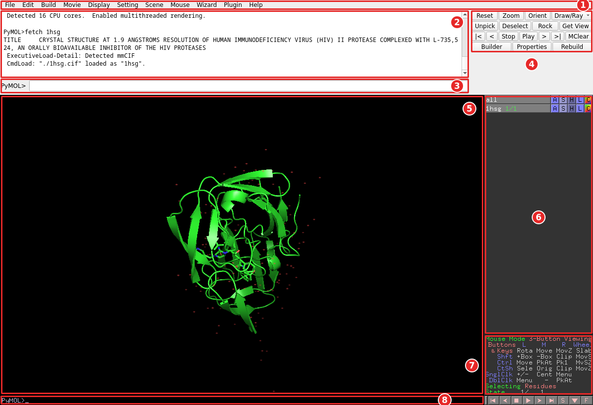

# 02. 基本操作

PyMOL の画面構成、マウス操作、構造の読み込みと表示の切り替え、画像・セッションの保存までを扱います。

インストールと起動は [01. インストールと起動](01-install.md) を参照してください。ここでは PyMOL 3.1 (conda 版) の画面で説明します。

> 参考: [おうちで解析 - PyMOL 基本操作](https://ouchidekaiseki.com/operation.php)
> 参考サイトは古いバージョンで説明されており、メニューのウィンドウと 3D 表示のウィンドウが分かれています。PyMOL 2.x 以降ではこの 2 つが 1 つのウィンドウにまとまっていますが、ボタンやメニューの役割は同じです。

## 画面構成

`pymol` で起動すると、1 つのウィンドウが開きます。下の画像は、起動後に `fetch 1hsg` で構造を読み込んだ状態です。



| 番号 | 部分 | 役割 |
| --- | --- | --- |
| 1 | メニューバー | ファイルの読み書き、表示設定、背景色など |
| 2 | ログ | 実行したコマンドとその結果が表示される |
| 3 | コマンドライン | PyMOL コマンドを入力する |
| 4 | ボタン | よく使う操作。`Reset` (視点を初期化)、`Zoom` (全体が収まるように拡大)、`Orient` (分子が見やすい向きにする)、`Draw/Ray` (高品質な画像を作る) など |
| 5 | ビューア | 分子の 3D 表示。マウスで回転・拡大・移動する |
| 6 | オブジェクトパネル | 読み込んだ分子 (オブジェクト) と選択範囲の一覧。名前をクリックすると表示/非表示を切り替えられる |
| 7 | マウス操作の早見表 | 現在のマウスの割り当て (後述) |
| 8 | コマンドライン (ビューア側) | 3 と同じくコマンドを入力できる。ビューアをクリックした後はこちらに入力される |

### オブジェクトパネルの A / S / H / L / C ボタン

オブジェクトや選択範囲ごとに、5 つのボタンが並んでいます。`all` の行のボタンは、すべてのオブジェクトにまとめて効きます。

| ボタン | 名前 | 主な使い方 |
| --- | --- | --- |
| **A** | Action | `zoom` (拡大して表示)、`center` (中心に移動)、`delete` (削除) など |
| **S** | Show | 表示形式を **追加** する (`cartoon`、`sticks`、`surface` など) |
| **H** | Hide | 表示形式を **消す** (`everything` ですべて消す) |
| **L** | Label | ラベルを付ける (残基名、残基番号など) |
| **C** | Color | 色を変える |

> S (Show) は「追加」なので、元の表示は残ります。表示を切り替えたいときは、先に H (Hide) で消してから S で表示します。

---

## マウス操作

初期設定 (3 Button Viewing モード) での操作です。

### ドラッグ

| 操作 | 動作 |
| --- | --- |
| 左ドラッグ | 回転 |
| ホイールボタン (中ボタン) ドラッグ | 平行移動 |
| 右ドラッグ | 拡大・縮小 |
| ホイールを回す | 奥行き方向の表示範囲 (クリッピング) を調整する |

### クリック

| 操作 | 動作 |
| --- | --- |
| 左クリック | 原子を含む残基を選択に追加する / 選択済みなら外す。選択範囲は `(sele)` としてオブジェクトパネルに出る |
| ホイールボタンクリック | クリックした原子を回転の中心にする |
| 右クリック | クリックした場所のメニュー (Action メニュー) を開く |

> ノートパソコンのタッチパッドなどでホイールボタンが使えない場合は、メニューの `Mouse` → `2 Button Viewing` などに切り替えられます。現在の割り当ては、オブジェクトパネルの下にある早見表で確認できます。

### 表示がおかしくなったとき

- 分子が見えなくなった: `Reset` ボタンか、オブジェクトパネル `all` の `A` → `zoom`
- 分子の一部が欠けて見える: ホイールを回して表示範囲を広げるか、`Reset` で戻す

---

## 構造を読み込む

### ファイルから読み込む

メニューの `File` → `Open...` で、PDB ファイル (`.pdb`)、mmCIF ファイル (`.cif`)、セッションファイル (`.pse`) などを開きます。

コマンドで書く場合:

```
load protein.pdb
```

### PDB からダウンロードする

PDB ID が分かっている場合は、インターネットから直接読み込めます。メニューでは `File` → `Get PDB...` です。

```
fetch 1hsg
```

以下では、HIV-1 プロテアーゼと阻害剤 (インジナビル) の複合体 **1hsg** を例にします。

---

## タンパク質を表示する

PyMOL 2.x 以降では、読み込んだ直後から自動的に、タンパク質はリボン (cartoon)、リガンドは棒 (sticks)、水分子は小さな点で表示されます ([画面構成](#画面構成) の画像)。

ここでは表示の切り替えに慣れるため、いったんすべての表示を消し、タンパク質のリボン表示だけを付け直します。

### GUI で操作する

1. オブジェクトパネル `1hsg` の行の **H** → `everything` (すべての表示を消す)
2. 同じ行の **S** → `cartoon` (リボン表示)

### コマンドで操作する

```
hide everything
show cartoon
```

`show_as` を使うと、「今の表示を消して指定した形式だけ表示する」を 1 行で書けます。

```
show_as cartoon
```

### 主な表示形式

| 形式 | 見た目 | 主な用途 |
| --- | --- | --- |
| `lines` | 細い線 | 原子のつながりを軽い表示で確認する |
| `sticks` | 棒 | 低分子や側鎖を見る |
| `spheres` | 原子の大きさの球 | 分子の大きさや詰まり具合を見る |
| `cartoon` | リボン | タンパク質全体の構造 (へリックス、シート) を見る |
| `surface` | 分子表面 | ポケットの形や表面の性質を見る |

---

## タンパク質以外の分子 (リガンドなど) を表示する

上の操作 (すべて消してから `cartoon` を表示) をすると、リガンドは見えなくなります。`cartoon` はタンパク質と核酸にしか効かないためです。リガンドを選択して、`sticks` で表示します。

### GUI で操作する

1. メニューの `Display` → `Sequence` にチェックを入れる (ビューアの上部に配列が表示される)
2. 配列を右にスクロールし、タンパク質 (B 鎖) の配列のすぐ後ろにあるリガンド `MK1` をクリックする (その後ろに続く `HOH` は水分子)
   - 選択した部分がビューア上でピンクの点で強調され、オブジェクトパネルに `(sele)` が出る
3. オブジェクトパネル `(sele)` の行の **S** → `sticks`

ビューア上でリガンドの原子を直接左クリックしても選択できます。

### コマンドで操作する

`organic` は「タンパク質・核酸・水以外の有機分子」を指すキーワードです。

```
show sticks, organic
```

残基名で選んで、名前を付けた選択範囲にすることもできます。

```
select lig, resn MK1
show sticks, lig
```

### 色を変える

GUI ではオブジェクトパネルの **C** から選びます。コマンドでは次のように書きます。

```
color grey80, polymer      # タンパク質を灰色に
util.cbag organic          # リガンドの炭素を緑、他の元素は元素ごとの色に
```

### 選択を解除する

ビューアの何もない場所を左クリックするか、`Deselect` ボタンを押します。

```
deselect
```

---

## 画像を保存する

### GUI で保存する

1. 背景を白にする場合は、メニューの `Display` → `Background` → `White`
2. `Draw/Ray` ボタンを押し、サイズを指定して `Ray` を押す
   - Ray (レイトレース) は影や光沢をきれいに計算する処理です。論文やスライド用の画像は Ray してから保存します
3. `Save Image to File` で PNG ファイルとして保存する

メニューの `File` → `Export Image As` → `PNG...` からも保存できます。

> Ray した後に分子を回転させると、通常の表示に戻ります。必ず保存の直前に Ray してください。

### コマンドで保存する

`png` の `ray=1` を付けると、Ray してから保存します。

```
bg_color white
png 1hsg.png, width=1200, height=900, dpi=300, ray=1
```

背景を透明にしたい場合は、保存前に次を実行します。

```
set ray_opaque_background, 0
```

---

## セッションを保存する

セッションファイル (`.pse`) には、読み込んだ分子、表示形式、色、視点などの **作業状態がすべて** 保存されます。後から作業を再開したり、図を作り直したりするときのために保存しておきます。

### GUI で保存する

メニューの `File` → `Save Session As...` で `.pse` ファイルとして保存します。開くときは `File` → `Open...` でその `.pse` を選びます。

### コマンドで保存する

```
save 1hsg.pse     # 保存
load 1hsg.pse     # 開く
```

> `save` は拡張子で形式が決まります。`save 1hsg_edit.pdb` とすれば、PDB ファイルとして書き出せます (この場合、表示状態は保存されません)。

---

## まとめ: ここまでの操作をコマンドで書く

ここまでの操作は、次のスクリプトにまとめられます。`basic.pml` として保存し、PyMOL のコマンドラインで `@basic.pml` と入力するか、ターミナルで `pymol basic.pml` を実行すると、同じ図ができます。

```
# basic.pml
fetch 1hsg
hide everything
show cartoon
show sticks, organic
color grey80, polymer
util.cbag organic
orient
bg_color white
png 1hsg.png, width=1200, height=900, dpi=300, ray=1
save 1hsg.pse
```

GUI で試しながら操作を覚え、決まった手順はコマンドやスクリプトにしておくと、同じ図を何度でも作り直せます。
