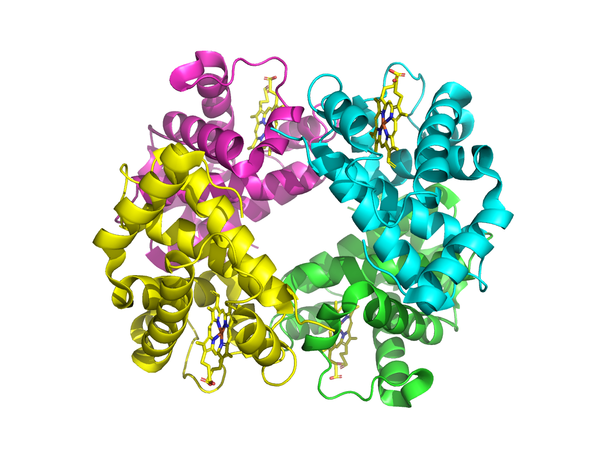
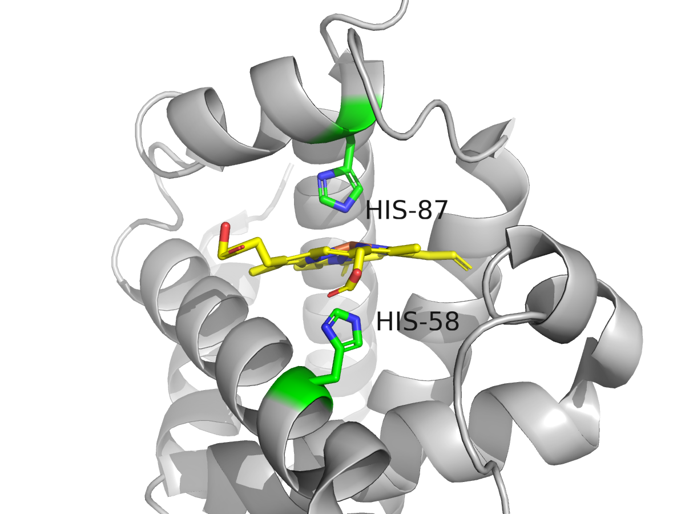

# 03. 演習: 図を作ってみる

[02. 基本操作](02-basic-operations.md) で学んだ操作だけを使って、ヘモグロビンの図を 2 枚作ります。

このページには **完成図と条件だけ** を載せています。操作手順は書いていないので、02 を見返しながら自分で考えて完成させてください。GUI で操作しても、コマンドで操作しても構いません。

## 題材: ヘモグロビン (PDB ID: 4hhb)

ヒトのデオキシヘモグロビンの結晶構造です。

| 項目 | 内容 |
| --- | --- |
| 鎖 (chain) | 4 本。A 鎖と C 鎖が α サブユニット、B 鎖と D 鎖が β サブユニット |
| ヘム | 各鎖に 1 つずつ、計 4 つ。残基名は `HEM`。中心に鉄 (Fe) 原子がある |
| 水分子 | 残基名 `HOH`。読み込むと小さな赤い点で表示される |

## 準備: 構造を読み込む

PyMOL を起動し、次のどちらかの方法で 4hhb を読み込みます。

- **GUI**: メニューの `File` → `Get PDB...` を開き、PDB ID の欄に `4hhb` と入力して `Download` を押す
- **コマンド**: コマンドラインに次のように入力する

  ```
  fetch 4hhb
  ```

オブジェクトパネルに `4hhb` が追加され、ビューアに構造が表示されれば準備完了です。

> 課題 1 と課題 2 は別々に作ります。課題 1 が終わったら、課題 2 に入る前にセッションを保存しておきましょう。メニューの `File` → `Reinitialize` → `Everything` (またはコマンド `reinitialize`) で初期状態に戻し、もう一度 4hhb を読み込むと、まっさらな状態から始められます。

---

## 課題 1: ヘモグロビン全体の図

### 完成図



### 条件

- [ ] 背景が白
- [ ] タンパク質はリボン (cartoon) 表示で、4 本の鎖がそれぞれ別の色
- [ ] 4 つのヘムが棒 (sticks) 表示で、炭素は黄色、窒素は青、酸素は赤
- [ ] 水分子は表示しない
- [ ] 4 本の鎖とヘムがすべて画面に収まっている
- [ ] Ray (レイトレース) した画像を `4hhb_overview.png` として保存する
- [ ] セッションを `4hhb_overview.pse` として保存する

---

## 課題 2: ヘムの結合部位の拡大図

α サブユニット (A 鎖) のヘムと、それを上下から挟む 2 つのヒスチジンを拡大した図です。

| 残基 | 役割 |
| --- | --- |
| HIS-87 (A 鎖 87 番) | 近位ヒスチジン。ヘムの鉄に直接結合している |
| HIS-58 (A 鎖 58 番) | 遠位ヒスチジン。ヘムをはさんで反対側にあり、酸素が結合する場所の近くにある |

### 完成図



### 条件

- [ ] 背景が白
- [ ] A 鎖だけを表示する (B、C、D 鎖と水分子は表示しない)
- [ ] A 鎖はリボン表示で、灰色
- [ ] A 鎖のヘムが棒表示で、炭素は黄色
- [ ] HIS-58 と HIS-87 の側鎖が棒表示で、炭素は緑
- [ ] HIS-58 と HIS-87 に、残基名と残基番号のラベルが付いている
- [ ] ヘムと 2 つのヒスチジンが画面の中央に大きく写っていて、ヒスチジンがヘムを上下から挟んでいる様子が分かる
- [ ] Ray した画像を `4hhb_heme_site.png` として保存する
- [ ] セッションを `4hhb_heme_site.pse` として保存する

---

## 確認

- 分子の向き、拡大率、ラベルの位置は、完成図と完全に同じでなくて構いません。**条件を満たしていれば完成** です。
- 保存した `.pse` を開き直して、作業した状態がそのまま戻ることも確認してください。
- 手が止まったら、[02. 基本操作](02-basic-operations.md) の該当する節 (オブジェクトパネルの A / S / H / L / C ボタン、選択、画像・セッションの保存) を読み返してください。
