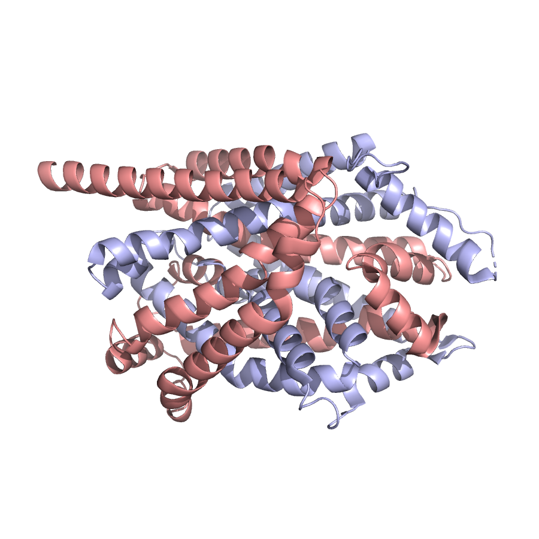
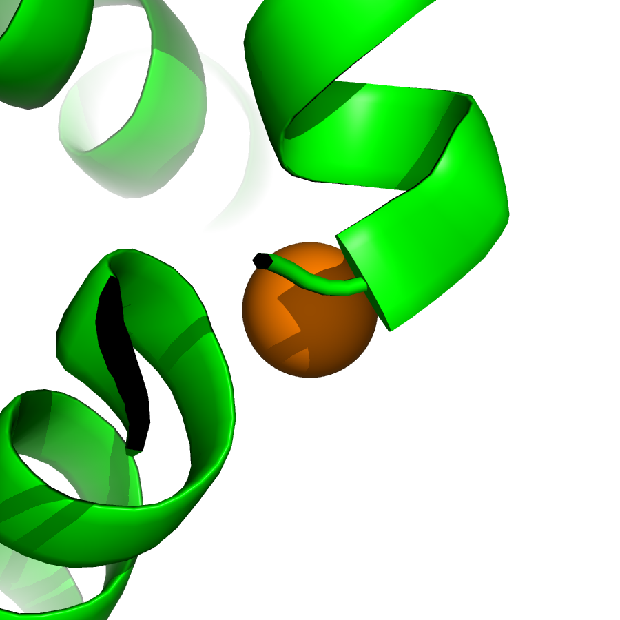
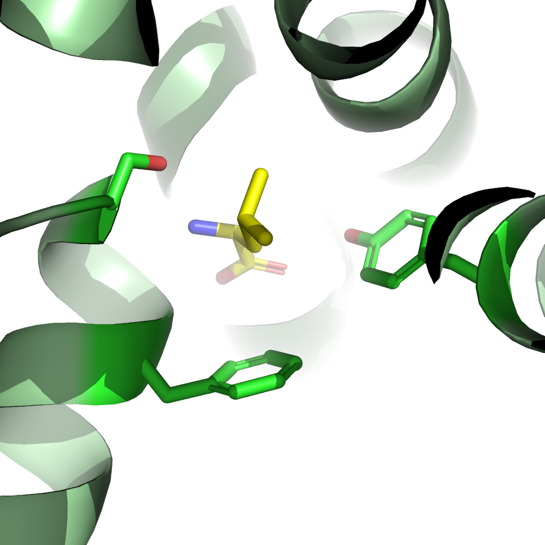

# 04. コマンドとスクリプトの基本

02 と 03 では、主に GUI で操作しました。この章からはコマンドを中心に使います。

GUI では同じ操作を毎回マウスでやり直す必要があり、細かい範囲の指定もできません。コマンドを使うと次のことができます。

- 「A 鎖の 100〜200 番の残基だけ」のような細かい指定
- 操作をファイル (スクリプト) に保存し、何度でも同じ図を作り直す
- GUI のメニューにない機能 (05 章以降で使う解析機能など) を使う

この章のゴールは、[参考論文 Fig 3A](08-final-exercise.md) の **Q1 (全体構造)、Q2 (イオンの表示)、Q3 (残基の表示)** のような図を、スクリプトで作れるようになることです。

題材には、論文と同じアミノ酸輸送体 **LeuT (PDB ID: 2a65)** を使います。2a65 には、タンパク質 (A 鎖) のほかに次の分子が含まれています。

| 残基名 | 内容 |
| --- | --- |
| `LEU` 601 | 基質のロイシン (タンパク質中のロイシンとは別の分子) |
| `NA` 751, 752 | ナトリウムイオン (Na⁺) |
| `CL` 753 | 塩化物イオン (Cl⁻) |
| `BOG` | 結晶化に使った界面活性剤 |
| `HOH` | 水分子 |

---

## コマンドラインの使い方

PyMOL のコマンドラインに入力して Enter を押すと、コマンドが実行されます (コマンドラインの場所は [02 の画面構成](02-basic-operations.md#画面構成) を参照)。

```
fetch 2a65
```

| 操作 | 動作 |
| --- | --- |
| `↑` / `↓` キー | 前に入力したコマンドを呼び出す |
| `Tab` キー | コマンド名やオブジェクト名を補完する |
| `help コマンド名` | コマンドの説明を表示する (例: `help show`) |

### コマンドの書き方

多くのコマンドは「`コマンド名 引数1, 引数2`」の形をしています。2 つ目の引数は、ほとんどの場合 **どの原子に対して実行するか (選択範囲)** です。

```
show sticks, resn LEU          # 「残基名が LEU の原子」を棒で表示
color red, chain A             # 「A 鎖」を赤にする
```

選択範囲を省略すると、すべての原子 (`all`) が対象になります。

---

## スクリプトを書いて実行する

コマンドをテキストファイルに並べて保存したものを **スクリプト** と呼びます。PyMOL のコマンドを並べたファイルは、拡張子を `.pml` にします。

```
# leut.pml
# 「#」から行末まではコメント (実行されない)
reinitialize
fetch 2a65
hide everything
show cartoon
bg_color white
```

スクリプトは次のどちらかの方法で実行します。

```bash
# ターミナルから (PyMOL が起動して、スクリプトが実行される)
pymol leut.pml
```

```
# PyMOL のコマンドラインから (「@」の後にファイル名)
@leut.pml
```

> PyMOL のコマンドラインでファイル名を指定するときは、PyMOL の **作業ディレクトリ** からの相対パスになります。`pwd` で現在の作業ディレクトリを確認し、`cd` で移動できます (例: `cd ~/pymol-work`)。

### `reinitialize` から始める

スクリプトの 1 行目には `reinitialize` を書いておくことをおすすめします。`reinitialize` は、読み込んだ分子や設定をすべて消して、起動直後の状態に戻します。

こうしておくと、スクリプトを何度実行しても、前の操作の影響を受けずに **毎回同じ結果** になります。

---

## 選択の文法

PyMOL の操作の多くは「どの原子に対して」を指定して行います。原子の性質 (属性) を使って、次のように指定します。

### よく使う属性

| 書き方 | 意味 | 例 |
| --- | --- | --- |
| `chain` | 鎖 | `chain A` |
| `resi` | 残基番号 | `resi 108`、`resi 100-200`、`resi 108+253+256` |
| `resn` | 残基名 | `resn LEU`、`resn NA+CL` |
| `name` | 原子名 | `name CA` (α 炭素)、`name N+C+O` (主鎖の原子) |
| `elem` | 元素 | `elem C`、`elem O` |
| `ss` | 二次構造 | `ss h` (へリックス)、`ss s` (シート)、`ss l+''` (ループ) |

`+` でつなぐと「どれか」、`-` でつなぐと「範囲」の意味になります。

### 分子の種類で選ぶ

| 書き方 | 意味 | 2a65 では |
| --- | --- | --- |
| `polymer` | タンパク質と核酸 | LeuT 本体 |
| `organic` | タンパク質・核酸以外の有機分子 | 基質のロイシン、界面活性剤 (BOG) |
| `inorganic` | 無機物 | Na⁺ と Cl⁻ |
| `metals` | 金属 | Na⁺ |
| `solvent` | 水 | HOH |

### 組み合わせる: `and` / `or` / `not`

| 書き方 | 意味 |
| --- | --- |
| `A and B` | A かつ B |
| `A or B` | A または B |
| `not A` | A 以外 |
| `( )` | 先に評価する部分をまとめる |

```
polymer and resi 1-100                 # タンパク質の 1〜100 番
resn NA or resn CL                     # Na⁺ と Cl⁻ (resn NA+CL と同じ)
not polymer and not solvent            # タンパク質でも水でもないもの
resn LEU and not polymer               # 基質のロイシン (タンパク質中の Leu は除く)
polymer and resi 108 and not name N+C+O    # 108 番の側鎖だけ
```

> `resn LEU` だけだと、タンパク質の中にある 61 個のロイシン残基もすべて選ばれます。基質のロイシンだけを選ぶには、`not polymer` を付けます。

---

## 選択範囲に名前を付ける: `select`

同じ選択を何度も使うときは、`select` で名前を付けておきます。

```
select ions, resn NA+CL
select substrate, resn LEU and not polymer
```

名前を付けた選択範囲はオブジェクトパネルに `(ions)` のように表示され、以降は名前だけで指定できます。

```
show spheres, ions
color yellow, substrate
```

選択した原子はビューア上でピンクの点で強調されます。強調を消すには `deselect` を使います (選択範囲そのものは残ります)。

```
deselect
```

> ビューアで原子をクリックしたときにできる `(sele)` も、同じ選択範囲です。コマンドで `sele` として使えます。

---

## 表示を変える: `show` / `hide` / `show_as`

| コマンド | 動作 |
| --- | --- |
| `show 形式, 選択` | 指定した形式の表示を **追加** する |
| `hide 形式, 選択` | 指定した形式の表示を **消す** (`hide everything` ですべて消す) |
| `show_as 形式, 選択` | 今の表示を消して、指定した形式 **だけ** にする |

```
hide everything                     # 全部消す
show cartoon, polymer               # タンパク質をリボンで
show spheres, ions                  # イオンを球で
show sticks, substrate              # 基質を棒で
```

主な表示形式は [02 の表](02-basic-operations.md#主な表示形式) を参照してください。

---

## 色を変える: `color` / `bg_color`

```
color green, polymer                # タンパク質を緑に
color purple, resn NA               # Na⁺ を紫に
bg_color white                      # 背景を白に
```

色名は `red`、`green`、`blue`、`yellow`、`orange`、`purple`、`grey70` (数字が大きいほど明るい灰色) などが使えます。使える色名は、GUI の **C** ボタンのメニューで確認できます。

### 元素ごとの色分け

棒表示の残基は、元素ごとに色分けすると見やすくなります。`util.cb○○` は「炭素を ○○ 色、ほかの元素 (N は青、O は赤など) は元素の色」にするコマンドです。

| コマンド | 炭素の色 |
| --- | --- |
| `util.cbag 選択` | 緑 (green) |
| `util.cbay 選択` | 黄 (yellow) |
| `util.cbac 選択` | シアン (cyan) |
| `util.cbaw 選択` | 白 (white) |
| `util.cnc 選択` | 炭素以外だけ元素の色にする (炭素は今の色のまま) |
| `util.cbc 選択` | 鎖ごとに違う色にする |

```
util.cbay substrate
```

---

## 視点を決める

| コマンド | 動作 |
| --- | --- |
| `orient 選択` | 選択範囲が見やすい向きに回転し、画面に収める |
| `zoom 選択, 余白` | 選択範囲が画面に収まるように拡大・縮小する。余白は Å 単位 (例: `zoom ions, 8`) |
| `center 選択` | 選択範囲を画面の中心に移動する (拡大率は変えない) |
| `turn 軸, 角度` | 画面の軸 (`x`、`y`、`z`) を中心に回転する (例: `turn y, 90`) |
| `clip slab, 厚さ` | 画面中心の前後、指定した厚さ (Å) の範囲だけを表示する。手前の構造が邪魔なときに使う |

### マウスで決めた視点をスクリプトに残す: `get_view`

マウスで調整した視点をスクリプトで再現したいときは、`get_view` を実行します。ログに次のような出力が出ます。

```
### cut below here and paste into script ###
set_view (\
     0.271275580,    0.901609838,   -0.336911619,\
    ...
    96.335266113,  148.044067383,  -20.000000000 )
### cut above here and paste into script ###
```

`set_view (` から `)` までをコピーしてスクリプトに貼り付けると、スクリプトの実行時に同じ視点が再現されます。

---

## シーンを保存する: `scene`

**シーン** は、その時点の「表示形式・色・視点」をまとめて、名前を付けて保存したものです。1 つのセッションに複数の図を保存しておき、名前を指定して切り替えられます。

```
scene Q1, store      # 今の状態を「Q1」として保存
scene Q1             # 「Q1」を呼び出す
scene *              # 保存されているシーンの一覧を表示
```

GUI では、メニューの `Scene` から保存・呼び出しができます。ビューアの下にあるボタンや、`Page Up` / `Page Down` キーでもシーンを順に切り替えられます。

シーンはセッションファイル (`.pse`) に一緒に保存されます。最終課題 ([08 章](08-final-exercise.md)) では、Q1〜Q8 の 8 個のシーンを 1 つのスクリプトで作ります。

> 1 つのシーンを作り終えたら、次のシーンを作る前に `hide everything` などで表示を整理すると、前のシーンの表示が混ざりません。

---

## 確認演習: 表示の図を作る

2a65 を使って、次の 3 つの図を作り、それぞれシーンとして保存してください。

このページには **完成図と条件だけ** を載せています。操作手順は、この章の説明を見返しながら自分で考えてください。

### 準備

次の内容で `ex04.pml` を作り、この後ろに自分のコマンドを書き足していきます。

```
reinitialize
fetch 2a65
bg_color white
```

最後に、スクリプトを `@ex04.pml` で **最初から実行し直しても** 3 つのシーンが正しく再現されることを確認してください。

### 練習 Q1: 全体構造



- [ ] タンパク質だけをリボンで表示する (水、イオン、基質、界面活性剤は表示しない)
- [ ] 1〜260 番の残基を水色 (`lightblue`)、261〜519 番の残基をサーモンピンク (`salmon`) にする
- [ ] タンパク質全体が画面に収まっている
- [ ] シーン `Q1` として保存する

### 練習 Q2: イオンを表示する



- [ ] タンパク質は緑のリボン
- [ ] Cl⁻ (`CL` 753) を橙色 (`orange`) の球で表示する
- [ ] Cl⁻ が画面の中心にあり、周りのへリックスが見える程度に拡大されている
- [ ] 手前のリボンで Cl⁻ が隠れていない
- [ ] シーン `Q2` として保存する

### 練習 Q3: 残基を表示する



- [ ] タンパク質は薄い緑 (`palegreen`) のリボン
- [ ] 基質のロイシン (`LEU` 601) を棒で表示し、炭素は黄色 (タンパク質中のロイシンは棒にしない)
- [ ] 基質を囲む 3 残基 TYR-108、PHE-253、SER-256 の **側鎖** を棒で表示し、炭素は緑
- [ ] 基質と 3 残基が画面の中心に大きく写っていて、手前のリボンで隠れていない
- [ ] シーン `Q3` として保存する

### 確認

- 向きや拡大率は完成図と完全に同じでなくて構いません。条件を満たしていれば完成です。
- `scene Q1`、`scene Q2`、`scene Q3` で、3 つの図を切り替えられることを確認してください。
