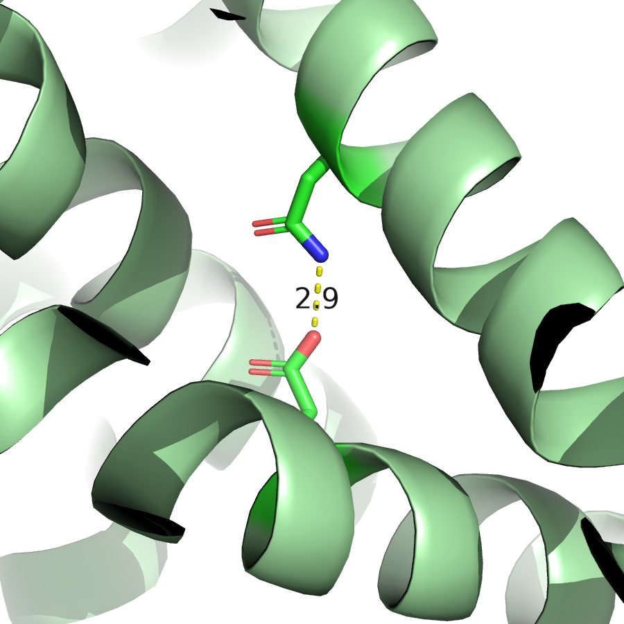
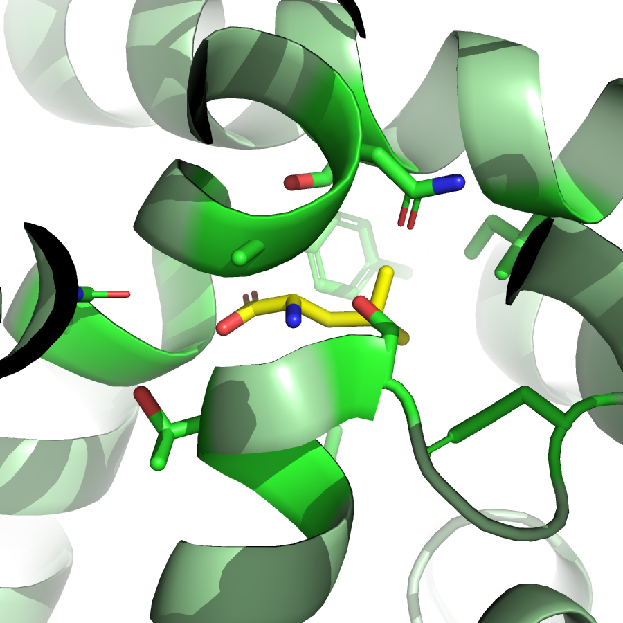

# 05. 選択の応用と距離の測定

この章では、構造を「解析」するための選択と測定を扱います。

- 1 つの原子を正確に指定する
- 2 つの原子の距離を測る
- 「ある分子から X Å 以内にある残基」を選ぶ

この章のゴールは、[参考論文 Fig 3A](08-final-exercise.md) の **Q4 (距離の測定)、Q5 (近くの残基の選択)** のような図を作れるようになることです。題材は 04 章と同じ LeuT (2a65) です。

選択の基本 (`chain`、`resi`、`resn`、`name`、`and / or / not` など) は [04 章](04-commands-and-scripts.md#選択の文法) を参照してください。

---

## 1 つの原子を選ぶ

距離を測るには、まず両端の **原子** を 1 つずつ指定する必要があります。残基番号と原子名を組み合わせます。

```
# 179 番残基の ND2 原子
resi 179 and name ND2
chain A and resi 112 and name OE2
```

同じ指定は、`/オブジェクト/セグメント/鎖/残基番号/原子名` の形でも書けます (空欄は「指定なし」)。

```
/2a65//A/179/ND2
```

### 原子名を調べる

原子名は、ビューアで原子をクリックするとログに表示されます (例: ``You clicked /2a65/A/A/ASN`179/ND2`` の最後の ``ND2`` が原子名)。

主な原子名は次のとおりです。

| 原子名 | 意味 |
| --- | --- |
| `N`、`CA`、`C`、`O` | 主鎖の原子 (CA は α 炭素) |
| `CB`、`CG`、`CD`… | 側鎖の炭素 (α 炭素から近い順に B、G、D、E、Z) |
| `OD1`、`OD2` | Asp の側鎖カルボキシ基の酸素 |
| `OE1`、`OE2` | Glu の側鎖カルボキシ基の酸素 |
| `ND2` / `OD1` | Asn の側鎖アミド基の窒素 / 酸素 |
| `NE2` / `OE1` | Gln の側鎖アミド基の窒素 / 酸素 |

---

## 距離を測る: `distance`

```
distance 名前, 原子1の選択, 原子2の選択
```

```
distance d1, resi 179 and name ND2, resi 112 and name OE2
```

2 つの原子の間に黄色の破線が引かれ、距離 (Å) のラベルが付きます。オブジェクトパネルには `d1` という **距離オブジェクト** が追加されます。

| 操作 | コマンド |
| --- | --- |
| 距離の数値だけをログに出す | `print(cmd.get_distance("resi 179 and name ND2", "resi 112 and name OE2"))` |
| ラベルを消す / 表示する | `hide labels, d1` / `show labels, d1` |
| 小数点以下の桁数を変える | `set label_distance_digits, 2` |
| 距離オブジェクトを削除する | `delete d1` |

> 選択に複数の原子が含まれていると、近くにある原子の組み合わせに何本も線が引かれ、どの距離を測ったのか分からなくなります。1 本だけ引きたいときは、両方とも 1 原子に絞り込んでください。

### GUI で測る

メニューの `Wizard` → `Measurement` を選ぶと、測定モードになります。ビューアで 2 つの原子を順にクリックすると、その間の距離が表示されます。終わったら、右下に出るパネルの `Done` を押します。

### 水素結合を探す

`mode=2` を付けると、指定した 2 つの選択の間にある **極性の接触 (水素結合の候補)** をまとめて表示します。

```
distance hb, resn LEU and not polymer, polymer, mode=2
```

GUI では、オブジェクトや選択範囲の **A** → `find` → `polar contacts` から、対象 (`within selection` など) を選んで同じことができます。

---

## 距離で選ぶ: `within` / `around`

「ある分子の近くにある原子」は、次のように選びます。

| 書き方 | 意味 |
| --- | --- |
| `A within X of B` | A のうち、B から X Å 以内にある原子 |
| `B around X` | B から X Å 以内にある原子 (B 自身は含まない) |
| `B expand X` | B から X Å 以内にある原子 (B 自身も含む) |

```
select near_atoms, polymer within 6 of resn NA
```

これで「Na⁺ から 6 Å 以内にある、タンパク質の原子」が選ばれます。2a65 では 96 原子です。

## 残基単位に広げる: `byres`

`within` で選ばれるのは **原子** です。残基の一部の原子だけが 6 Å 以内に入っている場合、その残基は途中で切れた状態で選ばれます。これを棒で表示すると、側鎖の一部だけが浮いているような図になります。

`byres` を付けると、選ばれた原子を含む **残基全体** に選択を広げます。

```
select near_na, byres (polymer within 6 of resn NA)
```

2a65 では 25 残基 (177 原子) が選ばれます。

> 同じように、`bychain` を付けると鎖全体に広がります。

### 側鎖だけを表示する

近くの残基を棒で表示するとき、主鎖の原子まで表示すると図が混み合います。リボンと一緒に表示するときは、主鎖の原子を除いて側鎖だけを表示すると見やすくなります。

```
show sticks, near_na and not name N+C+O
```

---

## 確認演習: 解析の図を作る

2a65 を使って、次の 2 つの図を作り、それぞれシーンとして保存してください。

このページには **完成図と条件だけ** を載せています。操作手順は、この章と 04 章の説明を見返しながら自分で考えてください。

### この課題で使う名前

| 対象 | 残基名 | 鎖 | 残基番号 | 原子名 |
| --- | --- | --- | --- | --- |
| 距離を測る残基 1 | `ASN` | A | 179 | `ND2` (側鎖アミド基の窒素) |
| 距離を測る残基 2 | `GLU` | A | 112 | `OE2` (側鎖カルボキシ基の酸素) |
| 基質のロイシン | `LEU` | A | 601 | |
| 主鎖の原子 | | | | `N`、`C`、`O` |

名前の調べ方や、ほかの構造の名前は [付録: 名前の一覧と調べ方](appendix-names.md) にまとめています。

### 準備

次の内容で `ex05.pml` を作り、この後ろに自分のコマンドを書き足していきます。

```
reinitialize
fetch 2a65
bg_color white
```

最後に、`@ex05.pml` で最初から実行し直しても 2 つのシーンが正しく再現されることを確認してください。

### 練習 Q4: 距離を測る



- [ ] タンパク質は薄い緑 (`palegreen`) のリボン
- [ ] ASN-179 と GLU-112 の側鎖を棒で表示し、炭素は緑
- [ ] ASN-179 の側鎖の窒素 (ND2) と、GLU-112 の側鎖の酸素 (OE2) の距離を測り、破線と数値を表示する
- [ ] 距離の値 (約 2.9 Å) をログでも確認する
- [ ] 2 つの残基と破線が画面の中心に大きく写っている
- [ ] シーン `Q4` として保存する

### 練習 Q5: 基質の周りの残基を選ぶ



- [ ] タンパク質は薄い緑のリボン
- [ ] 基質のロイシン (`LEU` 601) を棒で表示し、炭素は黄色
- [ ] 基質から **4 Å 以内** に原子を持つ残基を、残基単位で選び、名前を付ける
- [ ] その残基の側鎖を棒で表示し、炭素は緑 (13 残基になる)
- [ ] 基質が画面の中心にある
- [ ] シーン `Q5` として保存する

<details>
<summary>解答例 (クリックで表示)</summary>

解答は一例です。条件を満たしていれば、ほかの書き方や向きでも構いません。

`ex05.pml` の例です。

```
reinitialize
fetch 2a65
bg_color white

# ===== 練習 Q4: 距離を測る =====
hide everything
select pair, polymer and resi 112+179
show cartoon, polymer
color palegreen, polymer
show sticks, pair and not name N+C+O
util.cbag pair
distance d_q4, resi 179 and name ND2, resi 112 and name OE2
print(cmd.get_distance("resi 179 and name ND2", "resi 112 and name OE2"))
orient pair
zoom pair, 3
clip slab, 14
deselect
scene Q4, store

# ===== 練習 Q5: 基質の周りの残基を選ぶ =====
hide everything
select substrate, resn LEU and not polymer
select near_sub, byres (polymer within 4 of substrate)
# 13 になる
print(cmd.count_atoms("near_sub and name CA"))
show cartoon, polymer
color palegreen, polymer
show sticks, substrate
util.cbay substrate
show sticks, near_sub and not name N+C+O
util.cbag near_sub
orient substrate
zoom substrate, 7
clip slab, 14
deselect
scene Q5, store
```

</details>

### 確認

- 向きや拡大率は完成図と完全に同じでなくて構いません。条件を満たしていれば完成です。
- 練習 Q5 で選んだ残基の数は、`print(cmd.count_atoms("選択範囲の名前 and name CA"))` で確認できます (α 炭素は 1 残基に 1 個なので、残基数と同じになります)。
