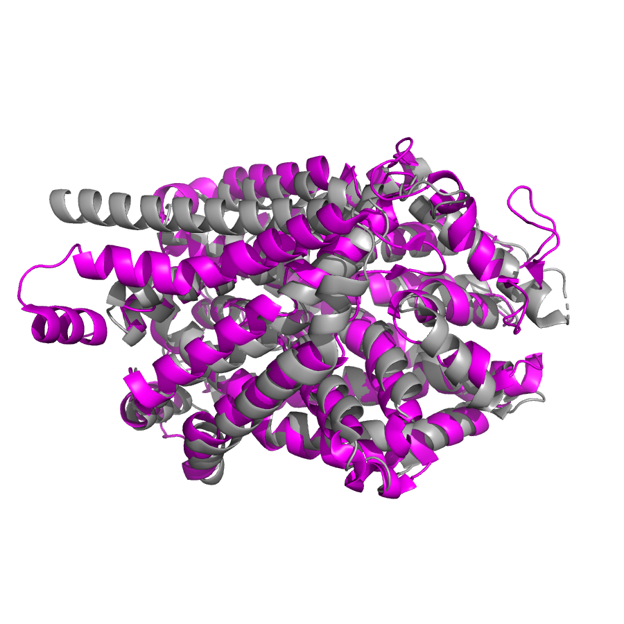

# 06. 構造の重ね合わせ

同じタンパク質の別の結晶構造 (結合している薬剤が違うものなど) や、似たタンパク質の構造を比べるときは、2 つの構造を **重ね合わせ** ます。

この章のゴールは、[参考論文 Fig 3A](08-final-exercise.md) の **Q6 (Align)** のような図を作れるようになることです。

---

## 複数の構造を読み込む

`fetch` は、スペースで区切って複数の PDB ID を一度に指定できます。

```
fetch 2a65 4m48
```

読み込んだ構造は、それぞれ別の **オブジェクト** になり、オブジェクトパネルに並びます。操作するときは、オブジェクト名で対象を指定します。

```
color grey70, 2a65
color magenta, 4m48
show cartoon, 4m48 and chain A
```

オブジェクトパネルで名前をクリックすると、そのオブジェクトの表示/非表示を切り替えられます。コマンドでは `disable 4m48` (非表示) と `enable 4m48` (表示) です。

### 座標は構造ごとにばらばら

PDB の構造は、それぞれの実験で決められた座標系で書かれています。同じタンパク質でも、別々に読み込むと **離れた位置や違う向き** で表示されることがよくあります。

例えば、LeuT の 2 つの結晶構造 2a65 と 2qju をそのまま読み込むと、ビューア上で大きく離れた位置に表示されます。これを重ねて比べられるようにするのが、重ね合わせです。

---

## 重ね合わせる: `align` / `super`

```
align 動かす構造, 基準の構造
```

1 つ目に指定した構造が動いて、2 つ目の構造に重なります。2 つ目の構造は動きません。

```
fetch 2a65 2qju
align 2qju, 2a65
```

### `align` と `super` の違い

| コマンド | やり方 | 向いている場合 |
| --- | --- | --- |
| `align` | まず **アミノ酸配列** を並べて対応する残基を決め、それから座標を重ねる | 同じタンパク質や、配列がよく似たタンパク質 |
| `super` | 配列を使わず、**立体構造の形** だけから対応する残基を探して重ねる | 配列があまり似ていないが、形が似ているタンパク質 |

どちらも書き方は同じです。

```
super 4m48 and chain A, 2a65
```

> もう 1 つ、`cealign 基準の構造, 動かす構造` という、形だけで重ねるコマンドもあります。**引数の順番が `align` / `super` と逆** なので注意してください。

GUI では、動かす構造の **A** → `align` → `to molecule (*/CA)` → 基準の構造名 で `align` を実行できます (α 炭素だけを使って重ねます)。

### 結果の読み方: RMSD

重ね合わせを実行すると、ログに次のような結果が出ます。

```
 Executive: RMSD =    0.115 (3415 to 3415 atoms)
```

| 部分 | 意味 |
| --- | --- |
| `RMSD = 0.115` | 重ねた原子どうしのずれの平均的な大きさ (Å)。小さいほどよく重なっている |
| `(3415 to 3415 atoms)` | 最終的に重ね合わせに使った原子の数 |

`align` と `super` は、重ね合わせを何回か繰り返し、そのたびにずれの大きすぎる原子を除いていきます (ログの `atoms rejected during cycle 〜`)。そのため、最終的な RMSD は **よく重なった部分だけ** の値になります。RMSD と一緒に、使われた原子の数も確認しましょう。

目安は次のとおりです。

| RMSD | 目安 |
| --- | --- |
| 0.5 Å 程度以下 | ほぼ同じ構造 (同じタンパク質の別の結晶構造など) |
| 1〜3 Å 程度 | 全体の形は似ているが、細かい違いがある (似たタンパク質どうしなど) |

### 例: LeuT とドーパミン輸送体

4m48 は、ショウジョウバエのドーパミン輸送体の構造です。LeuT と同じ仲間の輸送体で、配列はあまり似ていませんが、全体の形はよく似ています。

4m48 には、輸送体 (A 鎖) のほかに、結晶化のために結合させた抗体の断片 (H 鎖、L 鎖) が含まれています。重ね合わせと表示には、輸送体の A 鎖だけを使います。

```
align 4m48 and chain A, 2a65      # RMSD = 2.819 (2159 to 2159 atoms)
super 4m48 and chain A, 2a65      # RMSD = 2.323 (2343 to 2343 atoms)
```

同じタンパク質どうし (2a65 と 2qju、RMSD 約 0.1 Å) と比べると、RMSD がずっと大きくなります。また、配列を使わない `super` の方が、より多くの原子を使って重ねられています。

---

## 確認演習: 重ね合わせの図を作る

このページには **完成図と条件だけ** を載せています。操作手順は、この章と 04 章の説明を見返しながら自分で考えてください。

### 準備

次の内容で `ex06.pml` を作り、この後ろに自分のコマンドを書き足していきます。

```
reinitialize
fetch 2a65 4m48
bg_color white
```

### 練習 Q6: LeuT とドーパミン輸送体を重ねる



- [ ] 4m48 の A 鎖を、2a65 に重ね合わせる (`super` を使う)
- [ ] 2a65 は灰色 (`grey70`)、4m48 はマゼンタ (`magenta`) のリボン
- [ ] 4m48 の抗体 (H 鎖、L 鎖)、水、イオン、低分子は表示しない
- [ ] 2 つの構造全体が画面に収まっている
- [ ] シーン `Q6` として保存する
- [ ] ログに出た RMSD と原子数を確認し、`align` を使った場合と比べる

### 確認

- 向きや拡大率は完成図と完全に同じでなくて構いません。条件を満たしていれば完成です。
- 2 つの構造で、よく重なっている部分と、ずれている部分 (へリックスの位置が違う、片方にしかないループがある、など) を探してみてください。
