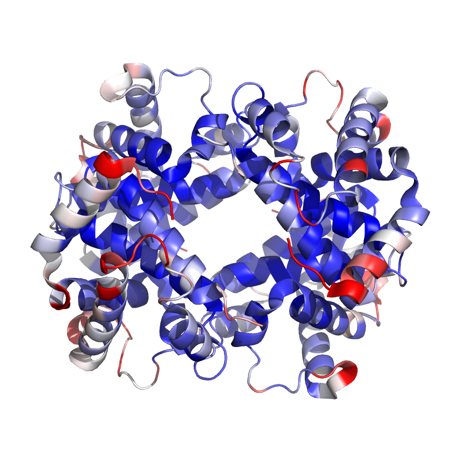
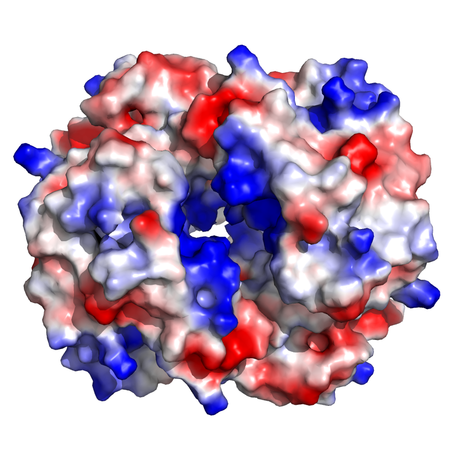

# 07. 情報を色で表す

構造の「形」だけでなく、原子や残基が持っている **数値の情報** を色のグラデーションで構造の上に表すことができます。

この章のゴールは、[参考論文 Fig 3A](08-final-exercise.md) の **Q7 (B-factor のマッピング)、Q8 (静電ポテンシャル)** のような図を作れるようになることです。

練習には、03 章で使ったヘモグロビン (4hhb) を使います。

---

## グラデーションで色を付ける: `spectrum`

```
spectrum 数値の種類, 色の並び, 選択
```

選択範囲の原子が持つ数値の最小値から最大値までを、色の並びに沿って塗り分けます。

### 例: N 末端から C 末端へ虹色にする

`count` は、選択範囲の原子に 1, 2, 3, … と順番に振った番号です。α 炭素 (`name CA`) だけを選ぶと、残基の順番になります。

```
spectrum count, rainbow, polymer and name CA
```

N 末端が青、C 末端が赤の虹色になり、鎖がどのようにたどっているかが分かります。

> リボン (cartoon) の色は、各残基の **α 炭素の色** で決まります。リボンをグラデーションで塗るときは、`name CA` だけを選べば十分です。

### 色の並び

| 書き方 | 色 |
| --- | --- |
| `rainbow` | 青 → 緑 → 黄 → 赤 |
| `blue_white_red` | 青 → 白 → 赤 |
| `blue_red` | 青 → 赤 |
| `red_white_blue` | 赤 → 白 → 青 (`blue_white_red` の逆) |

---

## B-factor を色で表す

### B-factor とは

X 線結晶構造の各原子には、座標と一緒に **B-factor (温度因子)** という数値が記録されています。B-factor は、結晶の中で **その原子の位置がどれだけ揺らいでいるか (はっきり決まっていないか)** を表します。

| B-factor | 意味 | よくある場所 |
| --- | --- | --- |
| 小さい | 位置がしっかり決まっている | タンパク質の内部、へリックスやシートの中央 |
| 大きい | 揺らいでいる、位置があいまい | 表面のループ、鎖の末端 |

### `spectrum b` で塗る

数値の種類に `b` を指定すると、B-factor で塗り分けます。

```
spectrum b, blue_white_red, polymer and name CA
```

B-factor の小さい残基が青、大きい残基が赤になります。

GUI では、オブジェクトの **C** → `spectrum` → `b-factors(*/CA)` で同じことができます。

### 色の範囲を指定する

`spectrum` は、選択範囲の最小値と最大値を自動で両端にします。ログに使われた範囲が表示されます。

```
 Spectrum: range ( 7.27000 to 76.16000).
```

一部の原子だけ値が極端に大きいと、ほとんどの部分が同じ色になってしまいます。その場合は `minimum` と `maximum` で範囲を指定します。範囲の外の値は、両端の色になります。

```
spectrum b, blue_white_red, polymer and name CA, minimum=10, maximum=40
```

> **PyMOL 3.x の注意**: mmCIF 形式で読み込むと、結晶中で見えていない残基 (座標が決まっていない残基) も、配列表示のために **座標なし・B-factor 0** の原子として読み込まれます。例えば 2a65 では、1〜4、133〜134、516〜519 番の α 炭素がこれにあたります。そのため自動の範囲が 0 から始まってしまうことがあります。`minimum` / `maximum` を指定するか、選択に `and q > 0` (占有率が 0 より大きい原子だけ) を付けて除外してください。

### 数値で選ぶ

B-factor などの数値は、選択の条件にも使えます。

```
select high_b, polymer and name CA and b > 50     # B-factor が 50 より大きい残基
```

---

## 表面を表示する: `surface`

```
show surface, polymer
```

分子の表面 (溶媒が触れられる面) を表示します。ポケットの形や、表面の性質を見るときに使います。

| 操作 | コマンド |
| --- | --- |
| 表面を半透明にする | `set transparency, 0.5` (0 で不透明、1 で透明) |
| 表面を消す | `hide surface` |

### 表面を作る前に、不要な分子を取り除く

`remove` は、選択した原子を構造から **削除** します (表示を消す `hide` と違い、元に戻せません。必要なら読み込み直します)。

```
remove solvent              # 水を削除
remove resn BOG             # 界面活性剤を削除
```

結晶化のときに結合していた水や界面活性剤が残っていると、表面や静電ポテンシャルの計算に混ざってしまいます。表面を表示する前に削除しておきます。

### 元の構造を残したいとき: `create`

`remove` は元の構造から原子を消してしまうため、同じ構造を使っているほかのシーン (イオンを表示したシーンなど) にも影響します。元の構造をそのまま残したいときは、`create` で **必要な部分だけのコピー** を新しいオブジェクトとして作り、そちらを使います。

```
create leut_prot, 2a65 and polymer      # 2a65 のタンパク質部分だけをコピーして「leut_prot」を作る
```

コピーには水や界面活性剤が含まれないので、`remove` する必要がありません。

---

## 静電ポテンシャルを表面に表示する

タンパク質の表面が、どこで正 (プラス) に、どこで負 (マイナス) に帯電しているかを、表面の色で表示できます。

### GUI で作る

オブジェクトの **A** → `generate` → `vacuum electrostatics` → `protein contact potential (local)`

### コマンドで作る

```
util.protein_vacuum_esp("4hhb", mode=2)
```

GUI の操作と同じ処理です。引数には **オブジェクト名** を指定します (`"4hhb and polymer"` のような選択範囲は指定できません)。タンパク質だけで計算したいときは、先に `remove` で不要な分子を削除するか、`create` でタンパク質だけのオブジェクトを作ってから、そのオブジェクト名を指定します。

実行すると、表面が次の色で塗られます。

| 色 | 意味 |
| --- | --- |
| 青 | 正の電位 (リシン、アルギニンなどの多いところ) |
| 白 | 中性 |
| 赤 | 負の電位 (アスパラギン酸、グルタミン酸などの多いところ) |

オブジェクトパネルには、元の構造とは別に、次のオブジェクトが追加されます。

| オブジェクト | 内容 |
| --- | --- |
| `4hhb_e_chg` | 計算用の構造のコピー。**色付きの表面** はこのオブジェクトに表示される |
| `4hhb_e_map` | 計算した電位のデータ |
| `4hhb_e_pot` | 色と数値の対応を示すカラーバー |

カラーバーが不要な場合は `disable 4hhb_e_pot` で非表示にできます (表面の色はそのまま残ります)。

> 実行時に `WARNING: some unassigned atoms are being deleted` と表示されることがあります。計算用のコピー (`_e_chg`) から、電荷を割り当てられなかった原子が除かれたという意味で、元の構造は変わりません。

> この機能は、真空中での簡易的な計算で、**大まかな目安** です。論文などで正確な静電ポテンシャルが必要な場合は、APBS などの専用ソフトウェアで計算します。

---

## 確認演習: 情報を色で表す

4hhb を使って、次の 2 つの図を作り、それぞれシーンとして保存してください。

このページには **完成図と条件だけ** を載せています。操作手順は、この章と 04 章の説明を見返しながら自分で考えてください。

### 準備

次の内容で `ex07.pml` を作り、この後ろに自分のコマンドを書き足していきます。

```
reinitialize
fetch 4hhb
bg_color white
```

> 練習 Q8 では原子を削除するので、練習 Q7 を先に作ってください。

### 練習 Q7: B-factor を色で表す



- [ ] タンパク質だけをリボンで表示する (ヘム、水は表示しない)
- [ ] B-factor で、青 → 白 → 赤 のグラデーションに塗る
- [ ] 色の範囲は 10 (青) 〜 40 (赤) にする
- [ ] タンパク質全体が画面に収まっている
- [ ] シーン `Q7` として保存する

### 練習 Q8: 静電ポテンシャルを表示する



- [ ] 水とヘムを取り除いてから、静電ポテンシャルを計算する
- [ ] 静電ポテンシャルで色付けした表面だけを表示する (リボンなどは表示しない)
- [ ] カラーバーは表示しない
- [ ] タンパク質全体が画面に収まっている
- [ ] シーン `Q8` として保存する

### 確認

- 向きや拡大率は完成図と完全に同じでなくて構いません。条件を満たしていれば完成です。
- 練習 Q7 で、B-factor の大きい (赤い) 部分が、構造のどこにあるかを観察してみてください。
- 4 つのサブユニットに囲まれた中央の空洞の表面は、何色になっているでしょうか (ヒント: この空洞には、負に帯電した分子 2,3-BPG が結合します)。
