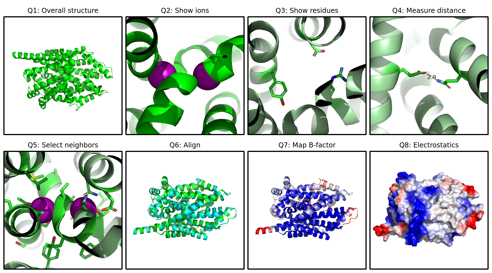
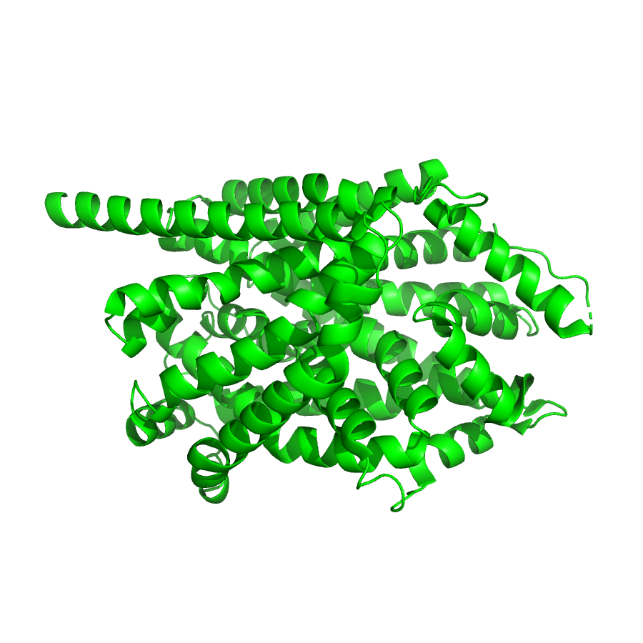
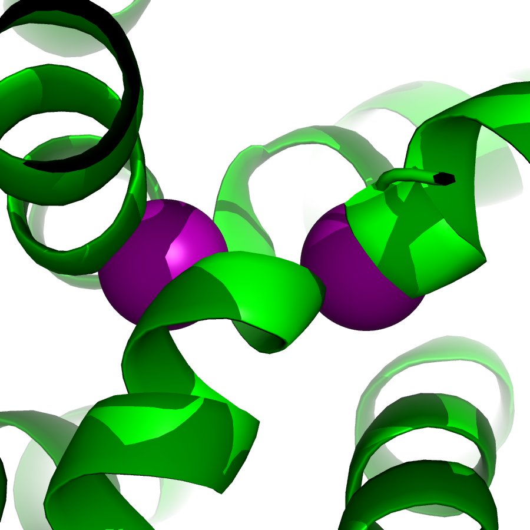
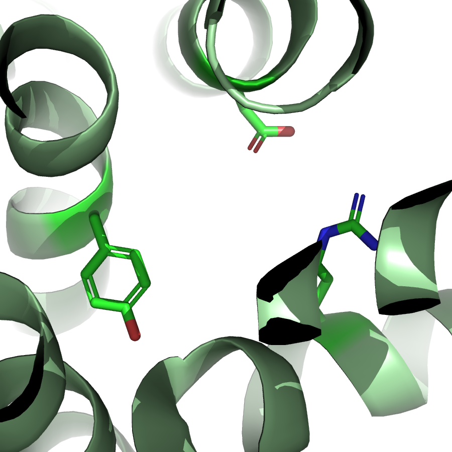
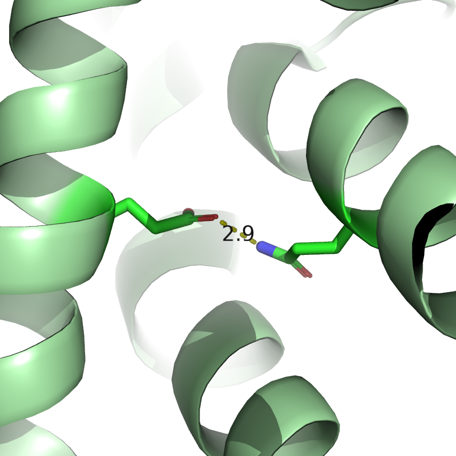
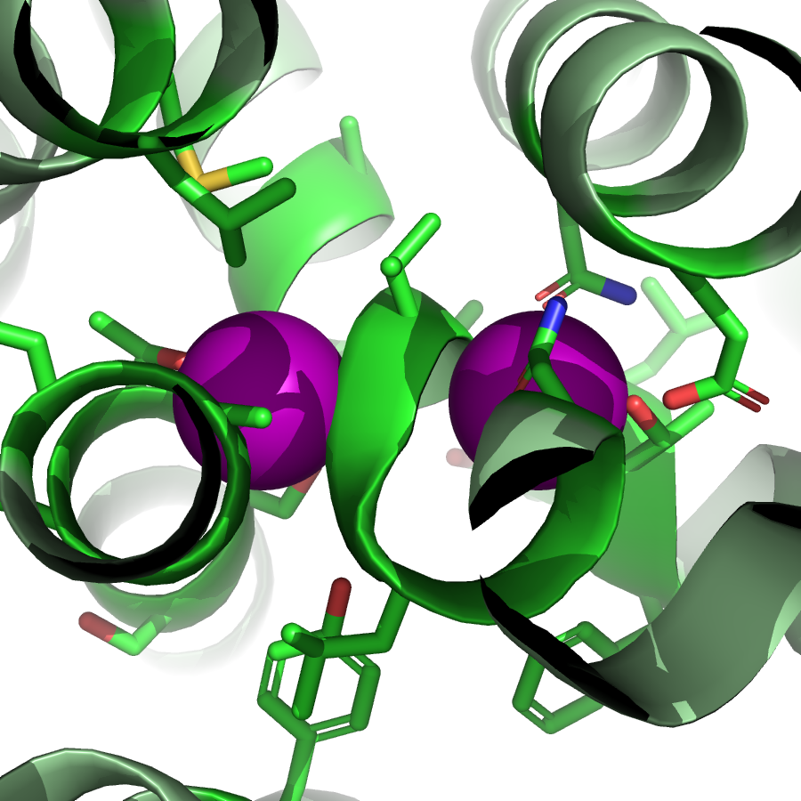
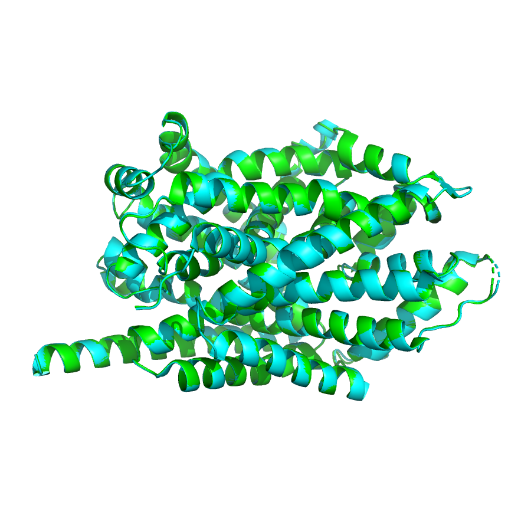
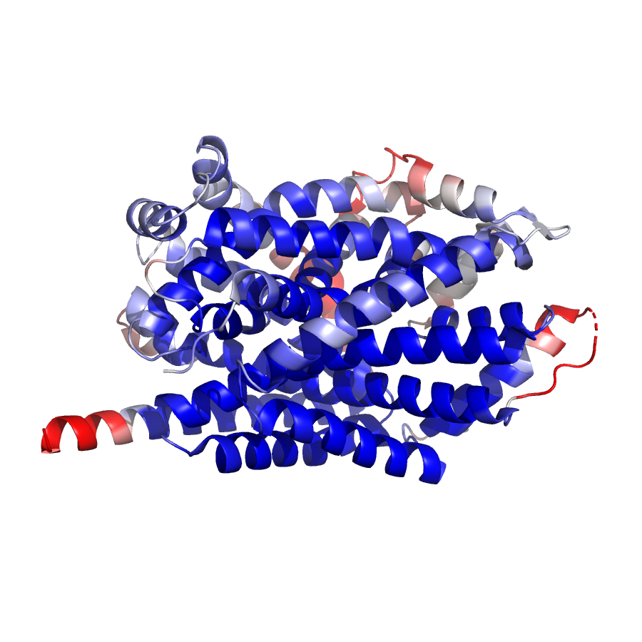
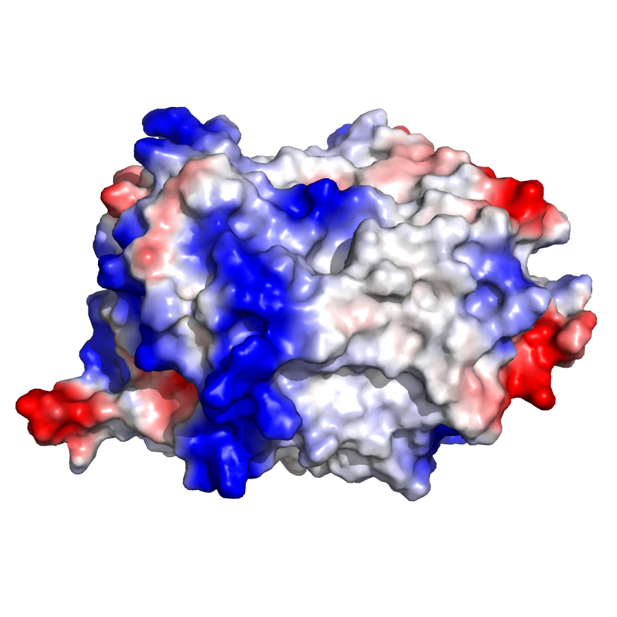

# 08. 最終課題: 論文 Fig 3A を再現する

参考論文 (`pymol-tutorial.pdf`、Kjaergaard et al., *The Biophysicist* 2022) の試験では、学生が 45 分で 8 つの課題を解き、答えを PyMOL スクリプトとして提出しました。この章では、それと同じ形式で、論文の **Fig 3A** にある 8 枚の図を自分のスクリプトで作ります。

ここまでの章で、必要な操作はすべて扱いました。このページには **完成図と条件だけ** を載せています。操作手順は書いていないので、04〜07 章を見返しながら自分で考えてください。



| 問題 | 内容 | 主に使う章 |
| --- | --- | --- |
| Q1 | 全体構造 | [04](04-commands-and-scripts.md) |
| Q2 | イオンの表示 | [04](04-commands-and-scripts.md) |
| Q3 | 残基の表示 | [04](04-commands-and-scripts.md) |
| Q4 | 距離の測定 | [05](05-selection-and-distance.md) |
| Q5 | 近くの残基の選択 | [05](05-selection-and-distance.md) |
| Q6 | 重ね合わせ | [06](06-structural-alignment.md) |
| Q7 | B-factor の色分け | [07](07-color-mapping.md) |
| Q8 | 静電ポテンシャル | [07](07-color-mapping.md) |

## 題材

アミノ酸輸送体 LeuT の 2 つの結晶構造を使います。

| PDB ID | 内容 |
| --- | --- |
| 2a65 | LeuT。基質のロイシン (`LEU` 601)、Na⁺ 2 個 (`NA` 751, 752)、Cl⁻ (`CL` 753) が結合している |
| 2qju | LeuT。抗うつ薬デシプラミン (`DSM` 801) が結合している。2a65 とは別の座標系で書かれている |

特に指定がない問題は、2a65 を使います。

### この課題で使う名前

| 構造 | 対象 | 残基名 | 鎖 | 残基番号 | 原子名 |
| --- | --- | --- | --- | --- | --- |
| 2a65 | LeuT (タンパク質) | | A | 1〜519 | |
| 2a65 | ナトリウムイオン (Na⁺) | `NA` | A | 751、752 | |
| 2a65 | 塩化物イオン (Cl⁻) | `CL` | A | 753 | |
| 2a65 | 基質のロイシン | `LEU` | A | 601 | |
| 2a65 | 界面活性剤 | `BOG` | A | 701〜705 | |
| 2a65 | 水 | `HOH` | A | 801〜 | |
| 2a65 | Q3 の残基 | `ARG`、`TYR`、`ASP` | A | 30、108、404 | |
| 2a65 | Q4 の残基 1 | `GLN` | A | 250 | `NE2` (側鎖アミド基の窒素) |
| 2a65 | Q4 の残基 2 | `GLU` | A | 290 | `OE1` (側鎖カルボキシ基の酸素) |
| 2qju | LeuT (タンパク質) | | A | 5〜515 | |
| 2qju | 表示しない分子 | `NA`、`CL`、`LEU`、`DSM` (デシプラミン)、`BOG`、`HOH` | A | | |
| 共通 | 主鎖の原子 | | | | `N`、`C`、`O` |

名前の調べ方や、ほかの構造の名前は [付録: 名前の一覧と調べ方](appendix-names.md) にまとめています。

## 準備: テンプレートスクリプト

論文の試験と同じく、構造の読み込みと、8 つの空のシーンを作るところまでを書いたテンプレートを用意しています。

[`templates/fig3a_template.pml`](../templates/fig3a_template.pml) を作業用のディレクトリにコピーし、各問題の `# ここにコマンドを書く` の部分を埋めていきます。

```
# ===== Q1: Overall structure (全体構造) =====
hide everything
# ここにコマンドを書く

scene Q1, store
```

各問題のブロックは `hide everything` で始まるので、前の問題の表示は消えた状態から始まります。ただし、**色、選択範囲、作ったオブジェクト、原子の削除・移動は次の問題に引き継がれます**。

すべてのシーンができたら、テンプレートの最後にある「画像の書き出し」の部分の `#` を外して実行し、8 枚の PNG を書き出します。

---

## Q1: Overall structure (全体構造)



- [ ] 2a65 のタンパク質だけを、緑 (`green`) のリボンで表示する
- [ ] イオン、基質、界面活性剤、水は表示しない
- [ ] タンパク質全体が画面に収まっている

## Q2: Show ions (イオンの表示)



- [ ] タンパク質は緑のリボン
- [ ] 2 個の Na⁺ を紫 (`purple`) の球で表示する (Cl⁻ は表示しない)
- [ ] 2 個の Na⁺ が画面の中心に大きく写っていて、手前のリボンで隠れていない

## Q3: Show residues (残基の表示)



- [ ] タンパク質は薄い緑 (`palegreen`) のリボン
- [ ] ARG-30、TYR-108、ASP-404 の 3 残基の **側鎖** を棒で表示し、炭素は緑
- [ ] 3 残基が画面の中心にあり、手前のリボンで隠れていない

> ARG-30 と ASP-404 は、LeuT の細胞外側の「ゲート」を作る残基として知られています。

## Q4: Measure distance (距離の測定)



- [ ] タンパク質は薄い緑のリボン
- [ ] GLN-250 と GLU-290 の側鎖を棒で表示し、炭素は緑
- [ ] GLN-250 の側鎖の窒素 (NE2) と、GLU-290 の側鎖の酸素 (OE1) の距離を測り、破線と数値を表示する (約 2.9 Å)
- [ ] 2 つの残基と破線が画面の中心に写っている

## Q5: Select neighbors (近くの残基の選択)



- [ ] タンパク質は薄い緑のリボン
- [ ] 2 個の Na⁺ を紫の球で表示する
- [ ] Na⁺ から **6 Å 以内** に原子を持つタンパク質の残基を、残基単位で選び、名前を付ける (25 残基になる)
- [ ] その残基の側鎖を棒で表示し、炭素は緑
- [ ] Na⁺ が画面の中心にある

## Q6: Align (重ね合わせ)



- [ ] 2qju を 2a65 に `align` で重ね合わせる (2a65 は動かさない)
- [ ] 2a65 は緑、2qju はシアン (`cyan`) のリボンで、タンパク質だけを表示する
- [ ] 2 つの構造全体が画面に収まっている
- [ ] ログに出た RMSD を記録する (約 0.1 Å)

## Q7: Map B-factor (B-factor の色分け)



- [ ] 2a65 のタンパク質だけをリボンで表示する
- [ ] B-factor で、青 → 白 → 赤 のグラデーションに塗る
- [ ] 色の範囲は 20 (青) 〜 45 (赤) にする
- [ ] タンパク質全体が画面に収まっている

## Q8: Electrostatics (静電ポテンシャル)



- [ ] 2a65 の **タンパク質部分だけ** (水、イオン、基質、界面活性剤を含めない) で、静電ポテンシャルを計算する
- [ ] 静電ポテンシャルで色付けした表面だけを表示する (カラーバーは表示しない)
- [ ] タンパク質全体が画面に収まっている
- [ ] Q8 を作った後でも、**Q2 と Q5 のシーンを呼び出すと Na⁺ が表示される** (ほかのシーンを壊さない)

---

## 確認

- [ ] `reinitialize` から始まるスクリプトを **最初から実行し直して**、8 つのシーンがすべて正しく再現される
- [ ] `scene Q1` 〜 `scene Q8` で、8 つの図を切り替えられる
- [ ] 8 枚の PNG (`fig3a_q1.png` 〜 `fig3a_q8.png`) とセッション (`fig3a.pse`) が保存されている

向きや拡大率は完成図と完全に同じでなくて構いません。条件を満たしていれば完成です。

論文の試験では、Q1 と Q2 はほぼ全員 (98%) が正解した一方、Q4 (1 原子の指定、76%) と Q5 (距離での選択、68%) の正答率が低めでした。うまくいかないときは、[05 章](05-selection-and-distance.md) の「1 つの原子を選ぶ」と「残基単位に広げる」を見返してください。
