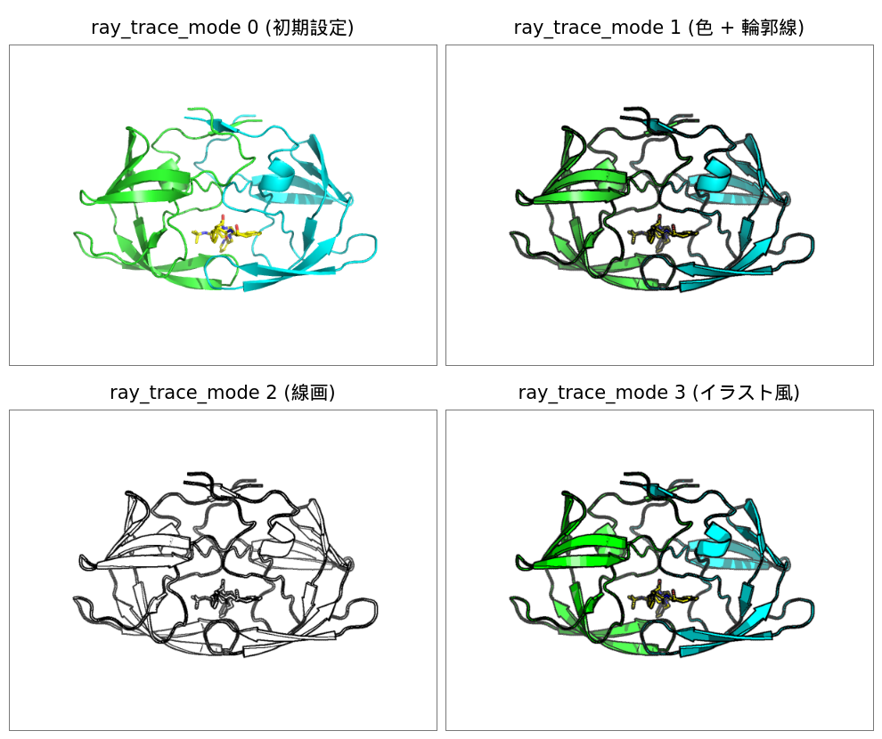
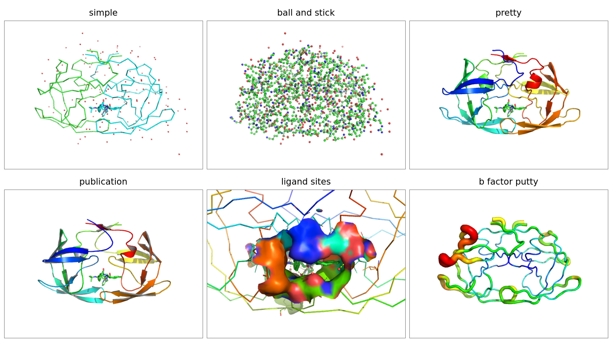
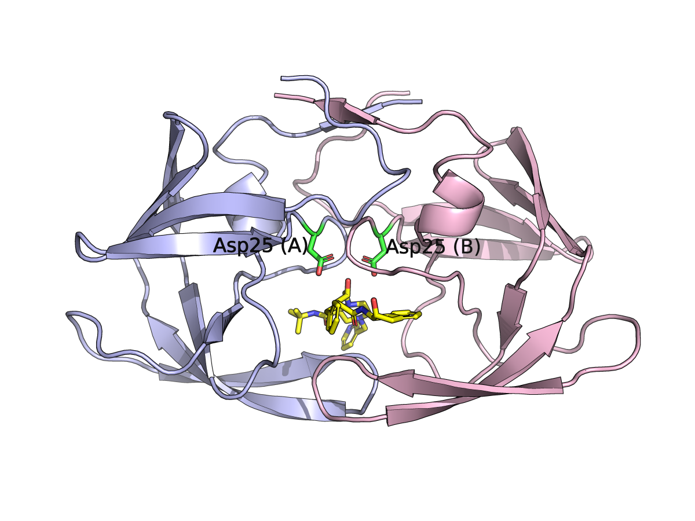

# 09. 論文・スライド用の図を作る

ここからは実践編です。08 章までで「何を表示するか」は一通り扱いました。この章では、作った図を **論文やスライドに載せられる品質** で書き出すための設定を扱います。

> 参考: [PyMOL Wiki - Practical Pymol for Beginners](https://wiki.pymol.org/index.php/Practical_Pymol_for_Beginners) の「Saving an image」。この章では、その内容を PyMOL 3.1 向けに広げています。

---

## 画像の大きさと解像度

### `png` で大きさを指定する

```
png figure.png, width=2400, height=1800, dpi=300, ray=1
```

| 引数 | 意味 |
| --- | --- |
| `width`、`height` | 画像の大きさ (ピクセル)。片方だけ指定すると、もう片方は画面の縦横比に合わせて決まる |
| `dpi` | 画像に記録する解像度。印刷したときの大きさが決まる |
| `ray=1` | Ray (レイトレース) してから保存する |

**印刷サイズ (インチ) = ピクセル数 ÷ dpi** です。例えば `width=2400, dpi=300` なら幅 8 インチ (約 20 cm) になります。

| 用途 | 目安 |
| --- | --- |
| 論文の図 (1 段幅、約 8.5 cm) | 幅 1000〜1200 ピクセル以上、300 dpi |
| 論文の図 (2 段幅、約 17 cm) | 幅 2000〜2400 ピクセル以上、300 dpi |
| スライド (全画面) | 幅 1920 ピクセル程度 |

> 投稿先の雑誌によって要求される解像度は違います。必ず投稿規定を確認してください。

### 画面の縦横比を合わせる: `viewport`

`png` で `width` と `height` の両方を指定すると、画面と縦横比が違う場合は、上下や左右が画面より広く (または狭く) 写ります。保存する画像と同じ縦横比に画面を合わせておくと、見たままの範囲が保存されます。

```
# ビューアを 800 × 600 (4:3) にする
viewport 800, 600
```

### Ray と `draw`

| 方法 | 特徴 |
| --- | --- |
| `ray=1` (または `ray` コマンド) | 影や光沢を計算した高品質な画像。時間がかかる |
| `draw 幅, 高さ` | 画面の描画 (OpenGL) をそのまま高解像度にする。速いが、影などは付かない (GUI 起動時のみ) |

基本は Ray を使います。Ray した画像は、分子を少しでも動かすと通常の表示に戻るので、`png ..., ray=1` のように保存と同時に Ray するのが確実です。

### 画面の表示品質を上げる

GUI での表示 (Ray していない状態) の品質は、メニューの `Display` → `Quality` で切り替えられます。`Maximum Quality` にすると、画面上のリボンや球がなめらかになります。

```
# Ray した画像の縁のギザギザを減らす (初期値 1)
set antialias, 2
```

---

## 背景

```
# 背景を白に
bg_color white
# 背景を不透明にする
set ray_opaque_background, 1
# 背景を透明にする
set ray_opaque_background, 0
```

背景を **透明** にした PNG は、スライドの色付きの背景や、ほかの図の上に重ねるときに便利です。

> **注意**: `ray_opaque_background` の初期値は `-1` (「画面の設定に従う」) です。GUI で起動したときは不透明になりますが、`pymol -c` (GUI なし) でスクリプトを実行すると **背景が透明になる** ことがあります。白い背景にしたいときは、スクリプトに `set ray_opaque_background, 1` を書いておくと確実です。

---

## Ray の描き方を変える: `ray_trace_mode`

`ray_trace_mode` を変えると、輪郭線を付けた描き方になります。



```
set ray_trace_mode, 1
```

| 値 | 描き方 |
| --- | --- |
| `0` | 通常 (初期設定) |
| `1` | 通常の色に、黒い輪郭線を追加 |
| `2` | 白黒の線画 |
| `3` | 色数を減らしたイラスト風 + 輪郭線 |

輪郭線の色と太さは、次の設定で変えられます。

```
# 輪郭線の色
set ray_trace_color, grey30
# 輪郭線の太さの調整 (大きいほど線が多く・太くなる)
set ray_trace_gain, 0.5
```

> 輪郭線は、画像のピクセル数に対して太さが決まります。大きな画像で書き出すと、線が相対的に細く見えます。

---

## 見た目を整える設定

| 設定 | 効果 |
| --- | --- |
| `set ray_shadow, 0` | Ray したときの影を消す |
| `set specular, 0` | 光沢 (ハイライト) を消して、マットな見た目にする |
| `set depth_cue, 0` / `set ray_trace_fog, 0` | 奥にある部分が白っぽくかすむ効果 (フォグ) を消す |
| `set cartoon_fancy_helices, 1` | へリックスの断面を、縁が丸い立体的な形にする |
| `set cartoon_transparency, 0.5` | リボンを半透明にする (0〜1) |
| `set transparency, 0.3` | 表面 (surface) を半透明にする (0〜1) |
| `set cartoon_side_chain_helper, 1` | リボンと棒を一緒に表示したとき、主鎖の原子を隠して側鎖だけを棒で見せる |
| `set stick_radius, 0.2` | 棒の太さ (初期値 0.25) |
| `set sphere_scale, 0.5` | 球の大きさの倍率 |

設定は、最後に選択範囲やオブジェクト名を付けると、その部分だけに適用できます。

```
# 2qju のリボンだけを半透明に
set cartoon_transparency, 0.6, 2qju
```

---

## プリセットを使う

オブジェクトの **A** → `preset` から、よく使う表示の組み合わせを一度に適用できます。図を作り始めるときの出発点として便利です。



| プリセット | 内容 |
| --- | --- |
| `simple` | 主鎖を線、低分子を棒で表示 |
| `ball and stick` | すべての原子を球と棒で表示 |
| `pretty` | リボンを虹色にして、低分子を棒で表示 |
| `publication` | `pretty` を、より論文向けの見た目 (へリックスの形など) にしたもの |
| `ligand sites` | 低分子の周りの残基と、結合ポケットの表面を表示 |
| `b factor putty` | B-factor が大きいほど太く、赤くなるチューブで表示 |

コマンドでは `preset.publication("1hsg")` のように書きます (`preset.simple`、`preset.ball_and_stick`、`preset.pretty`、`preset.ligand_sites`、`preset.b_factor_putty`)。

> プリセットは、表示形式だけでなく色や設定もまとめて変更します。プリセットを適用してから、自分で色などを調整するのがおすすめです。

---

## ラベルを整える

```
# 「ASP25」
label polymer and resi 25 and name CA, "%s%s" % (resn, resi)
# 「D25」(1 文字表記)
label polymer and resi 25 and name CA, "%s%s" % (oneletter, resi)
# 「Asp25 (A)」
label polymer and resi 25 and name CA, "Asp%s (%s)" % (resi, chain)
```

`%s` の部分に、後ろに並べた属性の値が順に入ります。よく使う属性は `resn` (残基名)、`resi` (残基番号)、`chain` (鎖)、`oneletter` (残基の 1 文字表記)、`name` (原子名) です。

| 設定 | 効果 |
| --- | --- |
| `set label_size, 18` | 文字の大きさ。書き出す画像を大きくすると、文字もそれに合わせて大きくなる |
| `set label_color, black` | 文字の色 |
| `set label_position, (x, y, z)` | 原子からのずらし量 (Å)。`z` を大きくするとカメラ側に出て、ほかの構造に隠れにくくなる |
| `set float_labels, on` | 画面上でラベルを常に手前に表示する |
| `set label_font_id, 7` | フォント (5〜16 などから選ぶ。7 は太字) |
| `hide labels` | ラベルを消す |

`label_position` も、選択範囲を付けると一部のラベルだけに適用できます。

```
set label_position, (-4, 2, 15), chain A and resi 25
set label_position, (4, 2, 15), chain B and resi 25
```

> Ray したとき、ラベルも 3 次元空間の中に置かれて描かれます。そのため、画面では見えていたラベルが、Ray した画像ではリボンに隠れることがあります。隠れる場合は、`label_position` の `z` を大きくして手前に出してください。

---

## 確認演習: 論文用の図を作る

HIV-1 プロテアーゼと阻害剤の複合体 (1hsg、02 章で使ったもの) で、論文に載せる図を作ります。

このページには **完成図と条件だけ** を載せています。操作手順は、この章を見返しながら自分で考えてください。

### 準備

```
reinitialize
fetch 1hsg
```

### この課題で使う名前

| 対象 | 残基名 | 鎖 | 残基番号 | 原子名 |
| --- | --- | --- | --- | --- |
| HIV-1 プロテアーゼ | | A、B | 1〜99 | |
| 阻害剤インジナビル | `MK1` | B | 902 | |
| 触媒残基 | `ASP` | A と B の両方 | 25 | ラベルを付ける原子は任意 (例: `CG`) |
| 主鎖の原子 | | | | `N`、`C`、`O` |
| 水 | `HOH` | | | |

名前の調べ方や、ほかの構造の名前は [付録: 名前の一覧と調べ方](appendix-names.md) にまとめています。

### 完成図



### 条件

- [ ] タンパク質はリボンで、A 鎖は水色 (`lightblue`)、B 鎖はピンク (`lightpink`)
- [ ] 阻害剤 (`MK1`) を棒で表示し、炭素は黄色
- [ ] 2 つの鎖の触媒残基 Asp25 の側鎖を棒で表示し、炭素は緑
- [ ] Asp25 に「Asp25 (A)」「Asp25 (B)」のラベルを付け、黒い文字で、リボンに隠れずに読める
- [ ] 輪郭線付きの描き方 (`ray_trace_mode 1`) にする
- [ ] 水は表示しない
- [ ] 白い **不透明** な背景で、幅 2400 × 高さ 1800 ピクセル、300 dpi の `1hsg_figure.png` を保存する
- [ ] 同じ図を **透明な背景** で `1hsg_figure_transparent.png` として保存する
- [ ] 一連の操作を `ex09.pml` にまとめ、`pymol -cq ex09.pml` (GUI なし) で実行しても同じ 2 枚の画像ができる

### 確認

- 向きや拡大率は完成図と完全に同じでなくて構いません。条件を満たしていれば完成です。
- 保存した画像を画像ビューアで開き、大きさと背景 (透明かどうか) を確認してください。
