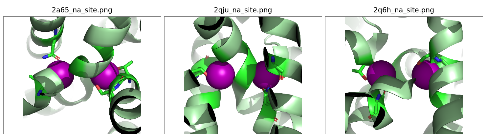

# 10. Python で自動化する

PyMOL は Python で書かれていて、PyMOL のすべてのコマンドを Python から呼び出せます。Python を使うと、`.pml` のスクリプトではできない次のことができます。

- 複数の構造に、同じ処理を **ループ** で繰り返す
- 原子や残基の情報を取り出して、**表 (CSV) に保存** する
- 条件によって処理を変える

この章では、Python の基本 (変数、`for` 文、リスト) を知っている前提で、PyMOL を Python から使う方法を扱います。あわせて、構造ファイルの書き出しと、操作の記録 (ログ) も扱います。

> 参考: [PyMOL Wiki - Practical Pymol for Beginners](https://wiki.pymol.org/index.php/Practical_Pymol_for_Beginners) の「Saving work」と「Scripting」

---

## コマンドと Python の対応

PyMOL のコマンドは、Python では `cmd.コマンド名(引数, ...)` という関数になります。引数は文字列として `"..."` で囲みます。

| PyMOL コマンド | Python |
| --- | --- |
| `fetch 2a65` | `cmd.fetch("2a65")` |
| `show sticks, resn LEU` | `cmd.show("sticks", "resn LEU")` |
| `color red, chain A` | `cmd.color("red", "chain A")` |
| `set ray_trace_mode, 1` | `cmd.set("ray_trace_mode", 1)` |
| `png a.png, width=800, ray=1` | `cmd.png("a.png", width=800, ray=1)` |
| `util.cbag organic` | `cmd.util.cbag("organic")` |

さらに、Python では **値を返す** 関数を使って、構造の情報を取り出せます。

| 関数 | 返す値 |
| --- | --- |
| `cmd.count_atoms("選択")` | 原子の数 |
| `cmd.get_distance("原子1", "原子2")` | 2 原子間の距離 (Å) |
| `cmd.get_chains("オブジェクト")` | 鎖の名前のリスト |
| `cmd.get_names()` | オブジェクト名のリスト |
| `cmd.align("動かす", "基準")` | 結果のリスト (先頭が RMSD) |

---

## Python を実行する 3 つの方法

### 1. `.py` ファイルを実行する

```python
# count_ions.py
from pymol import cmd

for pdb in ["2a65", "2qju"]:
    cmd.fetch(pdb)
    n = cmd.count_atoms(f"{pdb} and resn NA")
    print(pdb, "Na+:", n)
```

```bash
pymol -cq count_ions.py      # ターミナルから (GUI なし)
```

```
# PyMOL のコマンドラインから
run count_ions.py
```

### 2. `.pml` の中に Python を書く

`.pml` スクリプトの中では、`python` から `python end` までの行が Python として実行されます。

```
fetch 2a65
python
n = cmd.count_atoms("resn NA")
print("Na+:", n)
python end
show cartoon
```

### 3. コマンドラインに 1 行で書く

PyMOL のコマンドとして解釈できない行は、Python として実行されます。

```
print(cmd.count_atoms("resn NA"))
```

---

## 原子の情報を取り出す: `cmd.iterate`

`cmd.iterate` は、選択範囲の原子 1 つずつに対して、式を実行します。式の中では、`resn`、`resi`、`chain`、`name`、`b` (B-factor)、`q` (占有率)、`elem` などの属性を変数として使えます。

結果を受け取るには、`space` で辞書を渡し、その中のリストに追加していきます。

```python
residues = []
cmd.iterate("2a65 and polymer and name CA and resi 5-8",
            "residues.append((resn, resi, round(b, 2)))",
            space={"residues": residues})
print(residues)
# [('ARG', '5', 32.05), ('GLU', '6', 29.05), ('HIS', '7', 27.01), ('TRP', '8', 24.99)]
```

> `name CA` を付けると、1 残基につき 1 原子 (α 炭素) だけが対象になるので、残基の一覧が作れます。

> 式の中の変数名に `s` や `b` などの 1 文字を使うと、PyMOL 側の名前 (`s` は設定、`b` は B-factor) とぶつかります。`residues` のように意味のある名前を付けてください。

`.pml` の中や、コマンドラインから使う場合は、`stored` という入れ物を使うと `space` を省略できます。

```
python
from pymol import stored
stored.res = []
cmd.iterate("resn NA", "stored.res.append(resi)")
print(stored.res)
python end
```

---

## 結果を CSV に保存する

Python の `csv` モジュールで、取り出した情報を表として保存できます。Excel などで開けます。

```python
import csv
from pymol import cmd

cmd.fetch("2a65")
rows = []
cmd.iterate("2a65 and polymer and name CA and b > 50",
            "rows.append([resn, resi, round(b, 1)])",
            space={"rows": rows})

with open("high_b.csv", "w", newline="") as f:
    writer = csv.writer(f)
    writer.writerow(["resn", "resi", "b"])     # 見出しの行
    writer.writerows(rows)
```

---

## 複数の構造を一括で処理する

`for` 文で PDB ID を順に処理すると、同じ図や解析を何個の構造にでも繰り返せます。毎回 `cmd.reinitialize()` で状態を空にしてから始めると、前の構造の影響を受けません。

```python
from pymol import cmd

for pdb in ["2a65", "2qju", "2q6h"]:
    cmd.reinitialize()
    cmd.fetch(pdb)
    cmd.bg_color("white")
    cmd.set("ray_opaque_background", 1)
    cmd.hide("everything")
    cmd.show("cartoon", "polymer")
    cmd.orient("polymer")
    cmd.png(f"{pdb}_overview.png", width=1200, height=900, ray=1)
```

> `f"{pdb}_overview.png"` は Python の f 文字列で、`{pdb}` の部分が変数の値に置き換わります。選択範囲の文字列を作るときにも便利です (例: `f"{pdb} and resn NA"`)。

---

## 構造ファイルを書き出す: `save`

`save` は、拡張子に合わせた形式で、**選択した部分だけ** をファイルに書き出せます。

```
# タンパク質だけを PDB 形式で
save leut_protein.pdb, 2a65 and polymer
# mmCIF 形式で
save leut_protein.cif, 2a65 and polymer
# 基質だけを SDF 形式で (低分子向け)
save leucine.sdf, resn LEU and not polymer
# 水分子だけ
save waters.pdb, resn HOH
```

| 拡張子 | 形式 | 主な用途 |
| --- | --- | --- |
| `.pdb` | PDB | 多くのソフトウェアで読める |
| `.cif` | mmCIF | 大きな構造も扱える、現在の PDB の標準形式 |
| `.sdf` / `.mol2` | 低分子の形式 | ドッキングなど、低分子を扱うソフトウェアへ渡す |
| `.pse` | PyMOL セッション | PyMOL の作業状態ごと保存 |

重ね合わせ (06 章) をした後に `save` すると、**動かした後の座標** で保存されます。ほかのソフトウェアで、重ねた状態の構造を使いたいときに便利です。

### オブジェクトを分ける: `create` / `extract`

| コマンド | 動作 |
| --- | --- |
| `create 新しい名前, 選択` | 選択した部分を **コピー** して、新しいオブジェクトを作る (元はそのまま) |
| `extract 新しい名前, 選択` | 選択した部分を元のオブジェクトから **切り出して**、新しいオブジェクトにする |

```
# Na⁺ を 2a65 から切り離して、別のオブジェクトにする
extract na_ions, resn NA
```

---

## 操作を記録する: `log_open`

`log_open` を実行すると、それ以降に **コマンドラインで入力したコマンド** がファイルに記録されます。GUI で試行錯誤した手順をスクリプトとして残したいときに使います。

```
log_open mywork.pml
fetch 2a65
color red, resn NA
log_close
```

記録された `mywork.pml` は、次のようになります。

```
fetch 2a65, async=0
color red, resn NA
log_close
```

`@mywork.pml` で実行すると、同じ操作を再現できます。

> `@` で実行したスクリプトの中身は記録されません。

---

## 確認演習: Na⁺ の結合部位を一括で調べる

LeuT の 3 つの結晶構造 (2a65、2qju、2q6h) について、Na⁺ に配位している原子を調べ、表と画像にまとめる Python スクリプト `ion_sites.py` を書いてください。

このページには **期待される出力と条件だけ** を載せています。

### この課題で使う名前

| 構造 | ナトリウムイオン (`NA`) の残基番号 | そのほかの分子 |
| --- | --- | --- |
| 2a65 | 751、752 | `CL` 753、`LEU` 601、`BOG`、`HOH` |
| 2qju | 701、702 | `CL` 703、`LEU` 601、`DSM` 801、`BOG`、`HOH` |
| 2q6h | 751、752 | `LEU` 601、`CXX` 801・802 (クロミプラミン)、`BOG`、`HOH` (Cl⁻ は含まれない) |

Na⁺ の残基番号は構造ごとに違うので、スクリプトの中で番号を直接書かずに、残基名 `NA` から調べるようにすると、どの構造にも使えます。CSV の `atom` 列には原子名 (`O`、`OG1`、`OD1` など) を入れます。

名前の調べ方や、ほかの構造の名前は [付録: 名前の一覧と調べ方](appendix-names.md) にまとめています。

### 条件

- [ ] `pymol -cq ion_sites.py` で実行できる (GUI を使わない)
- [ ] 3 つの構造を、`for` 文で順に処理する
- [ ] 各構造の各 Na⁺ について、**3.0 Å 以内** にあるタンパク質の原子を調べる
- [ ] 結果を `ion_sites.csv` に保存する。列は `pdb, ion_resi, resn, resi, atom, distance` (距離は小数第 2 位まで)
- [ ] 構造ごとに、2 個の Na⁺ (紫の球) と、配位している残基の側鎖 (棒) を拡大した画像 `<PDB ID>_na_site.png` (白い背景) を保存する

### 期待される出力

`ion_sites.csv` は、見出しを除いて **33 行** になります。先頭は次のとおりです (2a65 の Na⁺ 2 個分)。

```
pdb,ion_resi,resn,resi,atom,distance
2a65,751,GLY,20,O,2.23
2a65,751,VAL,23,O,2.15
2a65,751,ALA,351,O,2.28
2a65,751,THR,354,OG1,2.25
2a65,751,SER,355,N,2.92
2a65,751,SER,355,OG,2.35
2a65,752,ALA,22,O,2.18
2a65,752,ASN,27,OD1,2.22
2a65,752,THR,254,O,2.31
2a65,752,THR,254,OG1,2.42
2a65,752,ASN,286,OD1,2.53
...
```

画像の例 (向きや拡大率は同じでなくて構いません):



<details>
<summary>解答例 (クリックで表示)</summary>

解答は一例です。条件を満たしていれば、ほかの書き方や向きでも構いません。

`ion_sites.py` の例です。

```python
import csv
from pymol import cmd

PDB_IDS = ["2a65", "2qju", "2q6h"]
CUTOFF = 3.0

rows = []
for pdb in PDB_IDS:
    cmd.reinitialize()
    cmd.fetch(pdb)
    ions = []
    cmd.iterate(f"{pdb} and resn NA", "ions.append(resi)", space={"ions": ions})
    for ion in ions:
        ion_sel = f"{pdb} and resn NA and resi {ion}"
        atoms = []
        cmd.iterate(f"({pdb} and polymer) within {CUTOFF} of ({ion_sel})",
                    "atoms.append((resn, resi, name))", space={"atoms": atoms})
        for resn, resi, name in atoms:
            d = cmd.get_distance(f"{pdb} and polymer and resi {resi} and name {name}", ion_sel)
            rows.append([pdb, ion, resn, resi, name, round(d, 2)])
    # image
    cmd.bg_color("white")
    cmd.set("ray_opaque_background", 1)
    cmd.hide("everything")
    cmd.show("cartoon", f"{pdb} and polymer")
    cmd.color("palegreen", f"{pdb} and polymer")
    cmd.show("spheres", f"{pdb} and resn NA")
    cmd.color("purple", f"{pdb} and resn NA")
    site = f"byres (({pdb} and polymer) within {CUTOFF} of ({pdb} and resn NA))"
    cmd.show("sticks", f"{site} and not name N+C+O")
    cmd.util.cbag(site)
    cmd.orient(f"{pdb} and resn NA")
    cmd.zoom(f"{pdb} and resn NA", 6)
    cmd.clip("slab", 16)
    cmd.png(f"{pdb}_na_site.png", width=800, height=800, ray=1)

with open("ion_sites.csv", "w", newline="") as f:
    w = csv.writer(f)
    w.writerow(["pdb", "ion_resi", "resn", "resi", "atom", "distance"])
    w.writerows(rows)
print(len(rows), "rows written")
```

</details>

### 確認

- 3 つの構造で、Na⁺ に配位している残基は同じでしょうか。距離はどのくらい違うでしょうか。
- 2qju では、Na⁺ の残基番号 (`ion_resi`) がほかの 2 つと違います。同じイオンでも、構造ごとに番号の付け方が違うことがあります。
