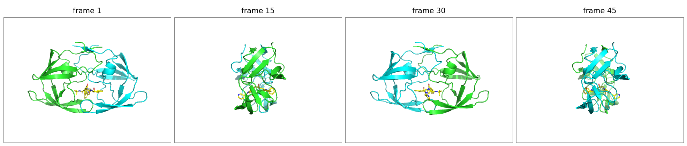
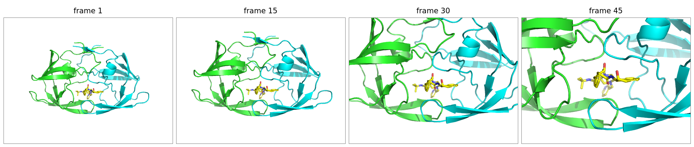
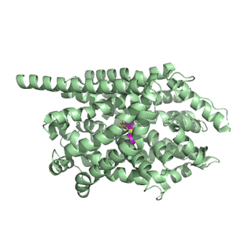

# 11. 動画を作る

タンパク質の立体構造は、静止画 1 枚では伝わりにくいことがあります。発表のスライドでは、構造がゆっくり回転する動画や、全体から結合部位へ寄っていく動画がよく使われます。この章では、PyMOL で動画を作って MP4 や GIF として書き出す方法を扱います。

> 参考: [PyMOL Wiki - Practical Pymol for Beginners](https://wiki.pymol.org/index.php/Practical_Pymol_for_Beginners) の「Movies」

---

## 準備: ffmpeg

PyMOL から MP4 を書き出すには、動画変換ソフト **ffmpeg** が必要です。入っているか確認します。

```bash
ffmpeg -version
```

`command not found` と表示された場合はインストールします。

```bash
sudo apt install ffmpeg
```

---

## 動画の仕組み: フレーム

PyMOL の動画は、**フレーム** (パラパラ漫画の 1 枚 1 枚) の並びです。各フレームの視点を決めておき、それを順に描画します。

| 用語 | 意味 |
| --- | --- |
| フレーム数 | 動画の長さ。1 秒あたり 30 フレームなら、120 フレームで 4 秒 |
| `mset 1 x120` | 120 フレームの動画を用意する |
| `mplay` / `mstop` | 動画を再生する / 止める (ビューアの下にある ▶ / ■ ボタンと同じ) |
| `mclear` | 動画の設定を消す |

---

## 回転する動画

### コマンドで作る

```
# 120 フレーム (30 fps で 4 秒)
mset 1 x120
# フレーム 1〜120 で、y 軸 (画面の縦軸) まわりに 1 回転
movie.roll 1, 120, 1, y
# 再生して確認
mplay
```

`movie.roll 開始, 終了, ループ, 軸` の「ループ」を `1` にすると、最後のフレームが最初のフレームにつながり、繰り返し再生しても途切れません。



### 首振り (rock)

1 回転ではなく、左右に一定の角度だけ往復させるには `movie.rock` を使います。

```
mset 1 x120
# 30° の幅で左右に往復
movie.rock 1, 120, 30, 0, 1, y
```

### GUI で作る

メニューの `Movie` → `Program` → `Camera Loop` から選びます。

| メニュー | 動き |
| --- | --- |
| `Y-Roll` → `4 seconds` など | y 軸まわりに 1 回転 |
| `Y-Rock` → `30 deg. over 4 sec.` など | y 軸まわりに左右に往復 |
| `X-Roll` / `X-Rock` | x 軸 (画面の横軸) まわり |
| `Nutate` | すりこぎ運動 (少し傾けながら回す) |

---

## シーンからシーンへ動く動画

04 章で扱った **シーン** を、決めたフレームに割り当てると、その間の視点が自動でなめらかにつながります。全体図から結合部位へ寄っていく動画などが作れます。

```
# 2 つのシーンを用意する
orient polymer
scene overview, store
zoom organic, 4
scene closeup, store

# 90 フレームの動画に、シーンを割り当てる
mset 1 x90
# フレーム 1 は全体図
mview store, 1, scene=overview
# フレーム 45 で結合部位に寄る
mview store, 45, scene=closeup
# フレーム 90 で全体図に戻る
mview store, 90, scene=overview
mplay
```



---

## 書き出す

### MP4 に書き出す: `movie.produce`

```
# 各フレームを Ray して書き出す
set ray_trace_frames, 1
movie.produce movie.mp4, quality=90
```

GUI では、メニューの `File` → `Export Movie As` → `MPEG...` で同じことができます。

> `ray_trace_frames` が `0` (初期設定) のときは、画面の描画のまま書き出します。速いですが、影などは付きません。Ray すると 1 フレームごとに時間がかかり、120 フレームでは数分かかることがあります。

> 動画の大きさは、ビューアの大きさで決まります。先に `viewport 1280, 720` などで大きさを決めてから書き出してください。

### 連番の PNG に書き出す: `mpng`

```
set ray_trace_frames, 1
mpng frames/frame, width=1280, height=720
```

`frames/frame0001.png`、`frames/frame0002.png`、… のように、フレームごとの PNG が保存されます。

保存先のディレクトリ `frames` は、先に作っておく必要があります (無いと `MoviePNG-Error: unable to write` になります)。ターミナルで `mkdir frames` とするか、スクリプトの中で次のように作ります。

```
python
import os
os.makedirs("frames", exist_ok=True)
python end
```GUI では `File` → `Export Movie As` → `PNG Images...` です。

連番の PNG は、ffmpeg で動画や GIF に変換できます。

```bash
# MP4 (30 fps)
ffmpeg -framerate 30 -i frames/frame%04d.png -c:v libx264 -pix_fmt yuv420p movie.mp4

# GIF (15 fps、幅 480 ピクセル)
ffmpeg -framerate 15 -i frames/frame%04d.png \
  -vf "fps=15,scale=480:-1:flags=lanczos,split[a][b];[a]palettegen[p];[b][p]paletteuse" \
  -loop 0 movie.gif
```

| 形式 | 向いている用途 |
| --- | --- |
| MP4 | スライド (PowerPoint など) に埋め込む、ファイルを小さくしたい |
| GIF | Web ページやチャットに貼る、ソフトウェアを問わず自動で繰り返し再生させたい |

> `-pix_fmt yuv420p` は、多くの動画プレーヤーや PowerPoint で再生できる形式にするための指定です。

---

## 確認演習: 回転する動画を作る

LeuT (2a65) が回転する動画を作ってください。

このページには **完成見本と条件だけ** を載せています。

### この課題で使う名前

| 対象 | 残基名 | 鎖 | 残基番号 |
| --- | --- | --- | --- |
| LeuT (タンパク質) | | A | 1〜519 |
| ナトリウムイオン (Na⁺) | `NA` | A | 751、752 |
| 基質のロイシン | `LEU` | A | 601 |
| 表示しない分子 | `CL` (Cl⁻)、`BOG` (界面活性剤)、`HOH` (水) | A | |

名前の調べ方や、ほかの構造の名前は [付録: 名前の一覧と調べ方](appendix-names.md) にまとめています。

### 完成見本



### 条件

- [ ] タンパク質は薄い緑 (`palegreen`) のリボン
- [ ] 2 個の Na⁺ を紫の球、基質のロイシンを棒 (炭素は黄色) で表示する
- [ ] 背景は白 (不透明)
- [ ] y 軸まわりに 1 回転する。繰り返し再生しても、つなぎ目で止まったり飛んだりしない
- [ ] 30 fps で 4 秒 (120 フレーム) の `leut_roll.mp4` を書き出す
- [ ] 同じ動画を、幅 480 ピクセル以下の `leut_roll.gif` としても書き出す
- [ ] 一連の操作を `ex11.pml` にまとめる

<details>
<summary>解答例 (クリックで表示)</summary>

解答は一例です。条件を満たしていれば、ほかの書き方や向きでも構いません。

`ex11.pml` の例です。`pymol -cq ex11.pml` で実行すると、数分かかります。

```
reinitialize
fetch 2a65
bg_color white
set ray_opaque_background, 1

# 表示
hide everything
show cartoon, polymer
color palegreen, polymer
show spheres, resn NA
color purple, resn NA
show sticks, resn LEU and not polymer
util.cbay resn LEU and not polymer
orient polymer

# 動画の大きさ (MP4 の大きさになる)
viewport 640, 640
zoom polymer, 2

# 120 フレーム (30 fps で 4 秒) で y 軸まわりに 1 回転。ループ = 1 でつなぎ目をなくす
mset 1 x120
movie.roll 1, 120, 1, y

# 各フレームを Ray して MP4 を書き出す
set ray_trace_frames, 1
movie.produce leut_roll.mp4, quality=90

# GIF 用に、連番の PNG も書き出す (保存先のディレクトリを先に作る)
python
import os
os.makedirs("frames", exist_ok=True)
python end
mpng frames/frame, width=480, height=480
```

GIF は、書き出した連番の PNG からターミナルで作ります。30 fps で読み込んで 15 fps に間引くので、MP4 と同じ 4 秒になります。

```bash
ffmpeg -framerate 30 -i frames/frame%04d.png \
  -vf "fps=15,scale=480:-1:flags=lanczos,split[a][b];[a]palettegen[p];[b][p]paletteuse" \
  -loop 0 leut_roll.gif
```

</details>

### 確認

- MP4 を動画プレーヤーで再生し、長さが 4 秒であることを確認してください。
- 余裕があれば、全体図から Na⁺ の結合部位に寄って戻る動画も作ってみてください。
